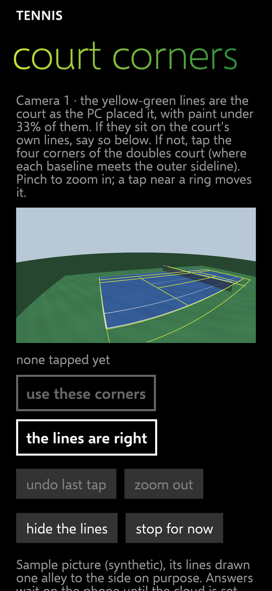
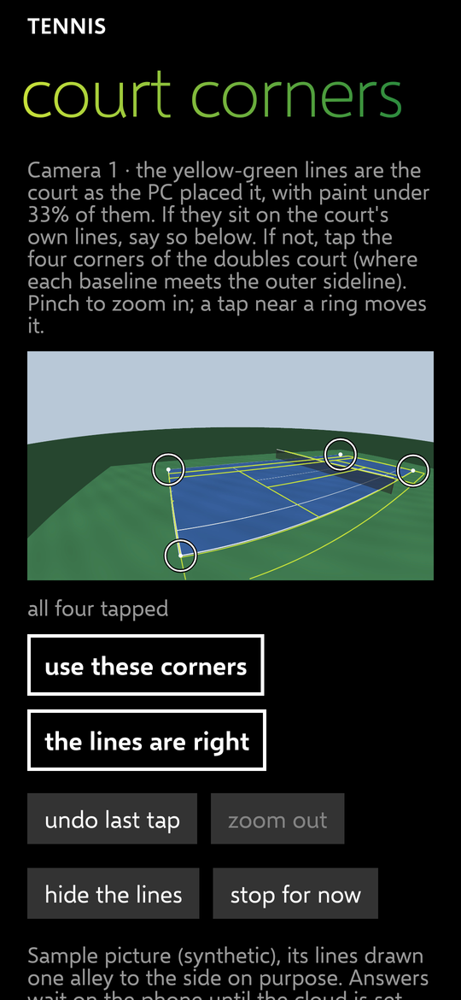

# When the PC doubts its court-line fit: hold, ask, four corners (TV-CAL-21, TV-CAL-22)

19 Nov 2026. Chris: "60% sits above a known-right fit (54%). Set the threshold from the Hero 7 side clip. When it fires, give me a fallback (tap the four court corners in the app) so a session isn't lost."

## What happens now

1. After each camera's pose is found from the court's lines, the PC measures how much of the fitted court's near-half lines has paint under it.
2. Under the alert level, that camera's fit is **doubtful**. The session **stops there**, before rally finding and detection (the hours-long part), and the phone gets "Camera 1 court lines ... Processing waits".
3. The PC sends that camera's picture of the empty court, with the fitted lines, to the app's **court corners** page.
4. Chris looks. If the drawn lines sit on the court's own lines: **the lines are right**. If not: tap the **four corners of the doubles court**, then **use these corners**.
5. The PC picks the answer up within a few minutes, places the camera from the taps, and the session runs on by itself. If the taps do not make a court (one on the wrong line), it asks again for that camera only.

If the PC has no cloud connection there is nobody to ask, so it processes the session with the alert only, as before.

| The page, as it opens (sample) | Four corners tapped |
| --- | --- |
|  |  |

The picture is synthetic (the test generator's court), with the fit drawn one doubles alley to the side on purpose: the mistake seen on real footage, where a sideline is laid on the neighbouring line.

## The alert level: 0.35 for now, to be set from the Hero 7 side clip

| Fit | Share of its near-half lines on paint |
| --- | --- |
| Wrong poses the search settled on (clay, and the taped court, with its line-crossing candidate switched off) | 0.16, 0.18 |
| Right poses (hard courts, clay, 25 Apr, 16 Apr) | 0.54 to 0.97 |
| Level now | **0.35**, midway |

Every one of those is a phone picture from behind a baseline. None is from beside a court, where the GoPros will be. So 0.35 is a placeholder, marked provisional in the code and on the retune list, and the Hero 7 clip from the side fence sets the real value. Until then expect it to be wrong in either direction: a right fit asked about (one tap on "the lines are right" releases it), or a wrong fit let through.

## Placing a camera from four taps

- The taps can be in any order. Every way of matching them to the doubles corners is tried; the pose that puts the corners on the taps through the lens wins. A match that swaps the court's long and short sides leaves the corners far from the taps and loses.
- A finger is only good to a few pixels, so the pose is then sharpened on the court's lines, **held within 0.7 m and 2 degrees of the tapped pose**. An alley is 1.37 m, so the lines can sharpen the pose but cannot pull it onto the neighbouring line. The sharpened pose is kept only if paint backs it at least as well as the tapped one.
- Taps that end more than 1% of the picture's width from a court's corners are not used; the app is asked again.

| Check | Result |
| --- | --- |
| Synthetic pictures, Wide and Linear lenses, both cameras, taps up to 6 px off in random order | camera within 0.1 m of the truth, usually about 2 cm (`fromCornersTest`) |
| No lines to sharpen on (blank picture): exact taps | within 1 cm |
| The same, taps a few px off | within 1 m (taps alone are coarse; the lines do the fine work) |
| Three taps | refused |
| Real phone pictures (four courts) with made-up taps 10 px off | within 1 cm of the known camera. Only two or three of the four corners are inside those pictures, so this proves the arithmetic and the sharpening, **not real tapping** |

## What is proven, and what is not

Proven by tests (numbers in docs/STATUS.md once CI has run):
- The pose from taps, and its refusals (`fromCornersTest`, 4 sections).
- Which fits are doubted, the picture and lines written for the app, the answer coming back at full-picture scale, a bad answer asked again (`calibCheckTest`, 3 sections).
- Through the whole pipeline on the synthetic session: a doubted fit stops before detection with both pictures written; tapped corners place camera 1 within 0.1 m; camera 2's nonsense taps are asked for again (`pipelineTest`, 2 new sections).
- The cloud routes: ask, answer, pull, applied; half an answer is not handed over; anything but four corners inside the picture or "accepted" is refused (3 tests).
- The app page: four taps reach the outbox in the picture's own pixels within a screen pixel of where they were tapped; pinch zooms and one finger pans without leaving a tap; undo, zoom out, hide the lines, "the lines are right" (6 tests); the page shows no even number on the sample.

Not proven:
- **Real taps on a real picture from beside a court.** The first Hero 7 side clip is the test.
- **The round trip itself.** The cloud service is not deployed (TV-PH-4), so the app shows only the bundled sample and its answers wait on the phone; the PC side is tested against a stand-in for the cloud.
- The watcher's own hold-and-skip lines (`tv.ingest.scanOnce`) have no test of their own; the parts they call do.

## Limits

- All four doubles corners must be in the picture. The framing check (TV-CAL-20) already warns when one is cut off.
- The empty-court picture travels through the cloud to the phone. It is built from 61 frames spread over the recording, taking each point's middle value, so anyone moving disappears; someone standing in one place for most of the recording could remain. It is stored privately like the session's other files and served only by the Worker.

## Also found while building this

Each processing stage was reused whenever its own settings were unchanged, without regard to the stages before it. New corners would have kept the old detections, and an indoor answer from the app re-ran the physics but kept the old shot numbers. Each stage now depends on the stages it is built on. No real session had been processed, so nothing wrong was shown.
