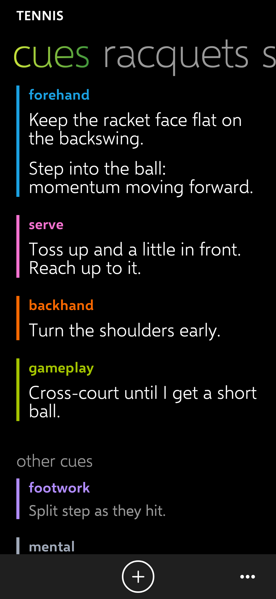

# Cues: smaller, grouped and colour-coded by stroke

Release: [v0.6.11](https://github.com/Wotworth/tennis/releases/tag/v0.6.11) (tag `cues-1`; CI passed). Spec v0.5 (CUE-01, CUE-03, CUE-10, VIS-08).

## What changed

- Pinned cues are about a third smaller (18 zpx, was 26), so about six fit on one screen.
- Cues are grouped by stroke: the stroke's name appears once, in its colour, with a colour bar beside its cues.
- Colours (Windows Phone accents): forehand cyan, backhand orange, serve pink, return teal, volley amber, footwork violet, **gameplay** lime, mental steel; a stroke you type yourself is light grey. All read on black at 4.5:1 or better (tested).
- **gameplay** is offered when you add or edit a cue.

Tests: 93 pass (2 new on the colours).

| Cues page (made-up cues) |
| --- |
|  |

## Test steps for Chris

1. Install this release. Your cues are still there, now grouped by stroke with colours.
2. Tap **+**, type "g" in **stroke** and pick **gameplay**; save. It shows in lime.
3. Check you can read your pinned cues without scrolling much.
