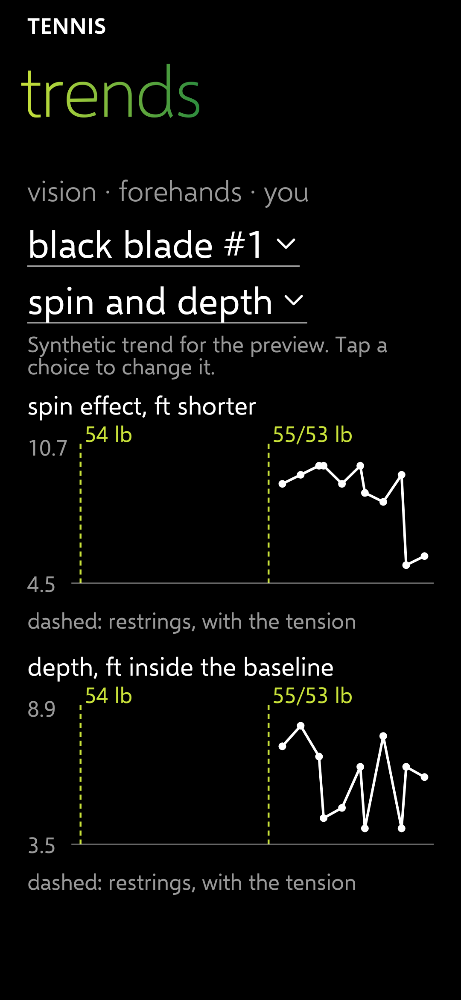

# Design v2, first build: the vision pages (VIS-09, 17 Nov)

Release: RELEASE_LINK

You asked for the app UI update we had discussed. I built your design v2 with my recommended picks from the [preview page](../preview/v2/README.md): **court B, shot A, trends A**. The look stays Metro (black, square, flat, no ripples or shadows). It is now easier to see what is chosen and to change it. This build covers the vision pages only; the rest of the app (cues, racquets, sessions, library) comes next.

| Court map | Shots | Shot card | Trends |
| --- | --- | --- | --- |
|  |  |  |  |

**Court map (court B)**
- **One filter bar** replaces the three rows of large words, so the map is about a third bigger.
- **The panel:** tapping the bar opens a full-width panel with every option as small square strips: shot type, colour by speed or spin, player, and the opponent's stats switch. It also has **done** and **reset**.
- **Colours:** you are green and your opponent is blue, each shaded dark to light by speed or spin, with a legend per player.
- **Tap a bounce** to open that shot.

**Shots list**
- **The same filter bar.** Your choices carry between the court and shots pages while the session is open.
- **A coloured square** marks each row's hitter.

**Shot card (shot A)**
- **The path** is drawn in the hitter's colour.
- **The figures** are in two columns, with the number large and its label small.
- **The bar at the bottom** has labelled icons: **previous**, **next** and **looks wrong**.

**Trends (trends A)**
- **Two choices:** the racquet and the measures (spin and depth, spin only, or depth only). Each is underlined with a chevron; tap it for the panel.
- **Forehands and you** stay plain words, because the trend data holds only your forehands so far.

**Not changed yet:** the rallies, 3D and health pages, and the rest of the app.

## What CI proved

CI_PROVED

## On your phone

PHONE_STEPS
