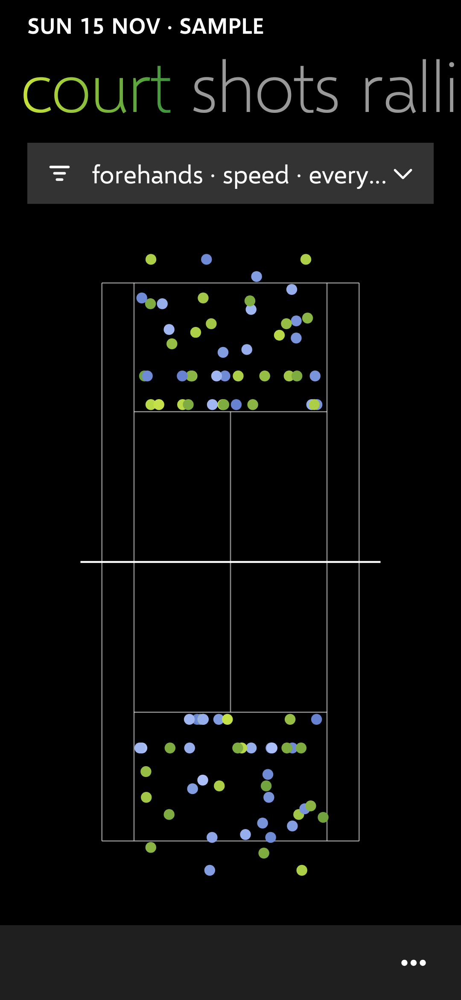
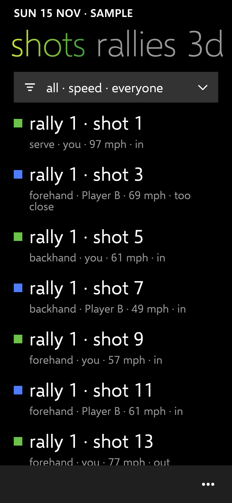
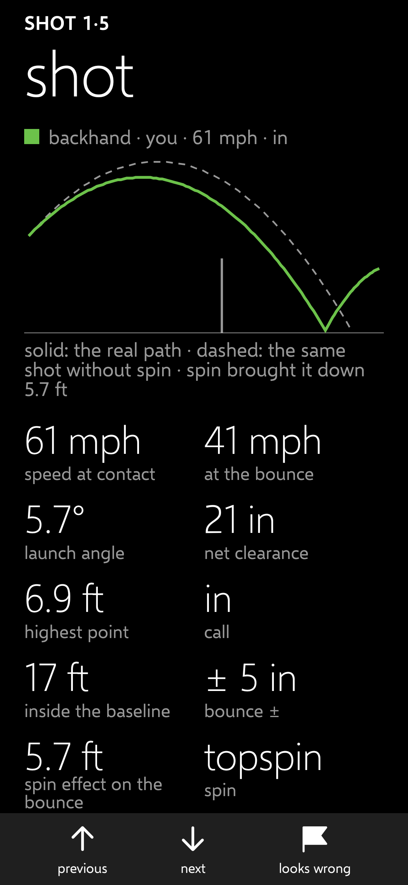

# Design v2, first build: the vision pages (VIS-09, 17 Nov)

Release: [v0.6.25](https://github.com/Wotworth/Tennis/releases/tag/v0.6.25)

You asked for the app UI update we had discussed. I built your design v2 with my recommended picks from the [preview page](../preview/v2/README.md): **court B, shot A, trends A**. The look stays Metro (black, square, flat, no ripples or shadows). It is now easier to see what is chosen and to change it. This build covers the vision pages only; the rest of the app (cues, racquets, sessions, library) comes next.

| Court map | Shots | Shot card | Trends |
| --- | --- | --- | --- |
|  |  |  |  |

**Court map (court B)**
- **One filter bar** replaces the three rows of large words, so the map is about a third bigger.
- **The panel:** tapping the bar opens a full-width panel with every option as small square strips: shot type, colour by speed or spin, player, and the opponent's stats switch. It also has **done** and **reset**.
- **Colours:** you are green and your opponent is blue, each shaded dark to light by speed or spin, with a legend per player.
- **Tap a bounce** to open that shot.

**Shots list**
- **The same filter bar.** Your choices carry between the court and shots pages while the session is open.
- **A coloured square** marks each row's hitter.

**Shot card (shot A)**
- **The path** is drawn in the hitter's colour.
- **The figures** are in two columns, with the number large and its label small.
- **The bar at the bottom** has labelled icons: **previous**, **next** and **looks wrong**.

**Trends (trends A)**
- **Two choices:** the racquet and the measures (spin and depth, spin only, or depth only). Each is underlined with a chevron; tap it for the panel.
- **Forehands and you** stay plain words, because the trend data holds only your forehands so far.

**Not changed yet:** the rallies, 3D and health pages, and the rest of the app.

## What CI proved

- **Build and release (run 44143001135): passed.** The app built, its unit and screenshot tests passed, the APK is signed, and the release is published.
- **The tests cover:**
  - both bundled footage tests load;
  - the spoof session shows only odd numbers;
  - every vision page renders on the sample session, including the new court, shots, shot card and trends pages.
- **Vision tests (MATLAB) on the footage-test code:** still running at the time of writing. The run before it passed 106 of 108; the 2 failures are the parked adjacent-courts test. The new steadying, still-ball, racquet and steered-search rules pass their unit tests in this session.

## On your phone

1. Install the APK from the release above.
2. Open the sample session, then the **court** page. Tap the grey bar at the top.
3. In the panel, change the shot type, colour and player, then tap **done**. The map, legends and bar should follow your choices.
4. Swipe to **shots**. The same choices should apply, with a green or blue square before each row.
5. Tap a shot. Check the two-column figures, then tap **previous**, **next** and **looks wrong** at the bottom.
6. Open **trends** on the stats page. Tap the racquet and the measures, and check the charts change.
7. Tell me whether it looks right and is easier to use, and what to change before I do the rest of the app.
