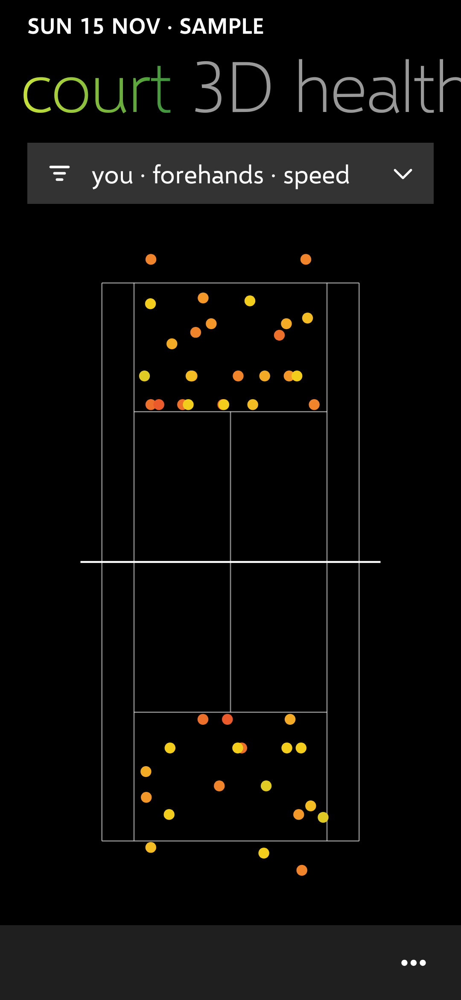
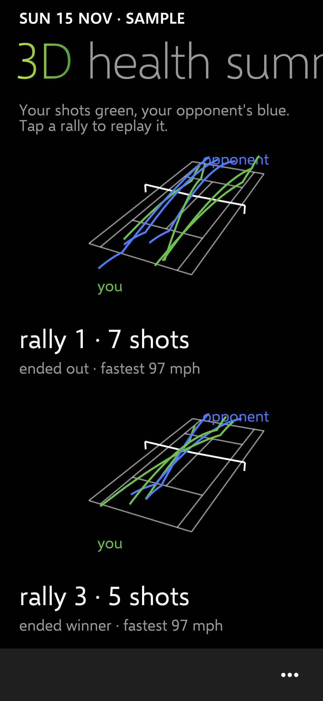
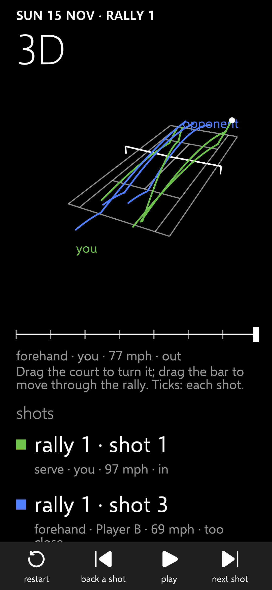
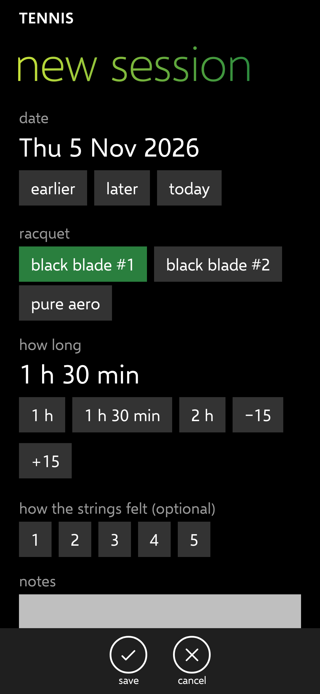
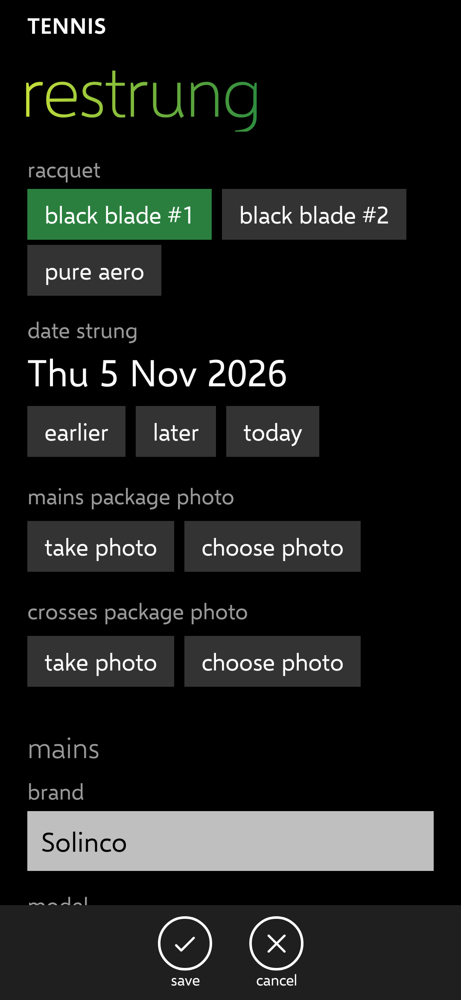

# Design v2, second build: your feedback on the vision pages (17 Nov)

Release: [v0.6.28](https://github.com/Wotworth/Tennis/releases/tag/v0.6.28)

| Court map | 3D tab | A rally |
| --- | --- | --- |
|  |  |  |

What changed, by your numbers:

1. **Rallies colour-coded:** your shots green, your opponent's blue, in the 3D tab's pictures and in the replay.
2. **Your end labelled:** "you" and "opponent" sit behind each baseline. Your end is always the near one, so every picture reads the same way, whichever end you played from.
3. **Replay:**
   - It's on its own page now, so dragging the bar no longer swipes to another tab.
   - The bottom bar has **restart**, **back a shot**, **play** and **next shot**.
   - Play runs at real speed, and pressed at the end it starts again. Ticks on the bar mark each shot.
   - The tab is named **3D**.
4. **Shots under the 3D view:** each rally's page lists its shots under the replay; tap one for its card. The separate shots tab is gone.
5. **Rallies become the 3D tab (as you suggested):**
   - The tabs are now **summary · court · 3D · health**.
   - The 3D tab lists every rally in perspective; tap one for its replay, shots and heart rate.
   - Tapping a bounce on the court map still opens that shot.
6. **Swiping on the tab names:** the headings now swipe like the page under them.
7. **Court colours:**
   - Speed or spin runs from deep green through yellow to red, with one legend.
   - The map shows **one player at a time** (your choice), picked in the filter bar's panel, starting with you.
8. **Heart rate per rally:** each rally's page shows the highest heart rate during the rally, and the lowest before the next point. The health tab stays.
9. **The rest of the app, first part:** the parts shared by every page now use the same look.
   - **Choices** (racquet, string feel, tile layout, camera layout, lens mode) are compact square segments, with the chosen one in tile green, instead of rows of large words.
   - **Small buttons** ("earlier · later · today", the duration presets, "take photo · choose photo") are flat square buttons, and their rows wrap.
   - **Bottom bar:** each round button now has its label underneath (save, cancel, add racquet, and so on).
   - **Next:** the hub pages (cues, racquets, sessions, stats, library) get filter bars where they list things.

| New session | Restrung |
| --- | --- |
|  |  |
10. **Older releases:** no change (your choice). If a release is worse, tell me and I'll fix it in a new one.

The spoof session's heart-rate readings were all made odd, so the per-rally figures also pass the odd-numbers check.

## What CI proved

- **Build and release (run 44165872844): passed.** The app built, its unit and screenshot tests passed, and the release is published.
- **The tests cover:**
  - every vision tab and every rally page renders on the sample session;
  - the spoof session shows only odd numbers, including the new per-rally heart rate;
  - the forms render with the new segments and buttons.
- **Not testable in CI:** dragging, playing at real speed and swiping on the tab names need the phone.

## On your phone

1. Install v0.6.28 from the release above, then open the sample session (Sessions → **vision · sample**).
2. **Tab names:** put your finger on the big names at the top and swipe. The tabs should change, and should read **summary court 3D health**.
3. **Court:** tap the grey bar and switch between **you** and your opponent. The dots should run from deep green through yellow to red, with one legend. Try **spin**.
4. **3D:** each rally should show your shots in green and your opponent's in blue, with **you** at the near end. Tap a rally.
5. **On the rally page:**
   - Tap **play**: the ball should move at real speed.
   - Try **back a shot**, **next shot** and **restart**, and tap **play** again at the end.
   - Drag the bar: it should move through the rally without changing tabs.
   - Drag the court to turn it.
6. Scroll down the rally page. Check the shots, and the **heart rate** (highest in the rally, lowest before the next point). Tap a shot for its card.
7. Open **log session** and **restrung**: the choices should be square segments, the buttons flat squares, and the bottom buttons labelled.
8. Tell me what still feels hard to use, and which page you'd like done next.
