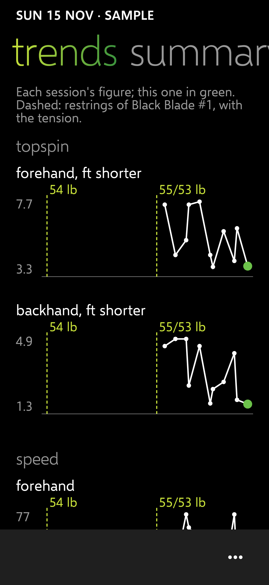

# Session summary: key figures against your average, and a trends tab (17 Nov)

Release: RELEASE_LINK

| Summary | Trends |
| --- | --- |
|  |  |

**Summary.** It now opens with your key figures for the session, each with "above / below / same as your average" and the average itself. "Your average" is the average of all your earlier sessions (your choice).
- **Topspin:** forehand and backhand: how many feet shorter spin made the ball land, against the same shot without spin.
- **Speed:** forehand and backhand at contact, serves left out.
- **Serves:** % in, speed, and spin (its commonest kind, such as topspin or slice, and how many feet shorter it made the serve land).
- **Accuracy:** % of your shots in, serves left out, and how deep the ones in landed.

The figures appear once "which one is you?" is answered, because until then the app doesn't know which player is you. The older per-player rows stay below.

**Trends tab.** A new fifth tab shows each figure over your sessions, with this session as a large green dot and the restrings of your racquet as dashed lines. That makes it easy to spot a change after new strings or a tweak.

**The sample session.** Its earlier sessions now have made-up figures too, and every number on these pages is still odd. The odd-numbers check passes.

## What CI proved

CI_PROVED

## On your phone

PHONE_STEPS
