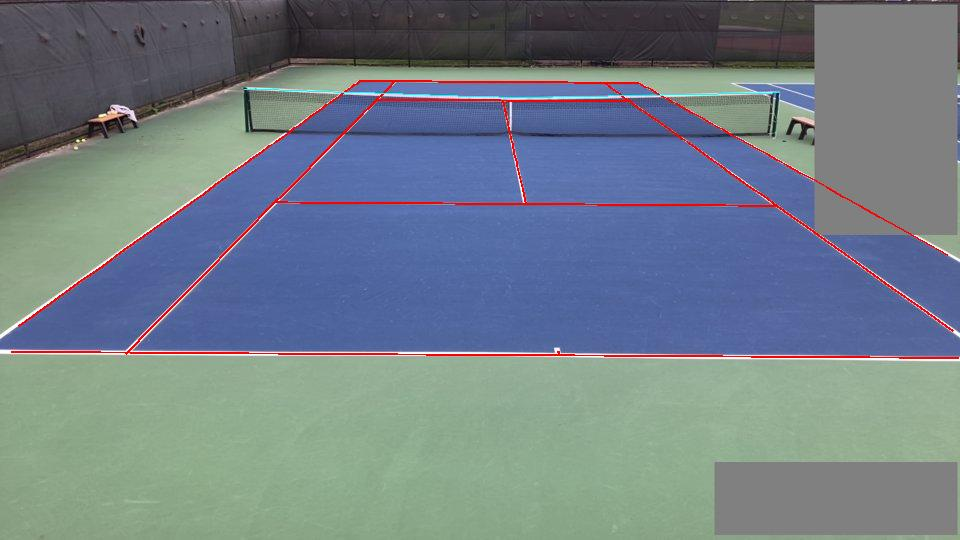
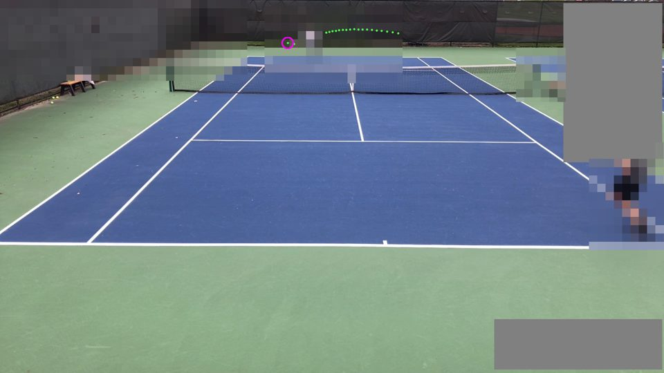

# Footage test 1: your two iPhone videos through the MATLAB stack (overnight, 17 Nov)

Release: RELEASE_LINK. In the app: Sessions → **footage tests** → each video's own page (summary, court, ball, bounces, rallies).

You asked me overnight to run both SwingVision exports through the same MATLAB code the PC will use, put the results in the app as if they were sessions, and decide anything that came up myself. Every decision is listed at the end and in DECISIONS.md (rows dated 2026-11-17).

**What this test can and can't show.** It uses one camera, so there are no 3D flights, speeds or spin; those need two cameras. What it does show is whether the code finds the court, the ball, bounces and the players on footage it has never seen. Video 2 was new to the code: none of the code's settings were tuned on it.

## Results at a glance

| | Video 1 (25 Apr 2025) | Video 2 (16 Apr 2025) |
| --- | --- | --- |
| Rallies found from the edit's cuts | V1_RALLIES | 34 (5:41 of video) |
| Court: distance from your hand-drawn lines (median of 8 points) | V1_SCORE | **6 px** (3 3 5 8 11 3 11 14) |
| Court: share of the fitted lines that lie on white paint | 96% | 95% |
| Lens width found (iPhone, not calibrated) | 64° | 65° |
| Corners out of view (the new warning, TV-CAL-20) | V1_CORNERS | near right singles, near right doubles, near left doubles |
| Ball found, when it was visible (hand check of 30 random frames) | V1_RECALL | **14 of 22 (64%)** |
| Tracked spots that were really the ball in flight (hand check) | V1_PREC | **16 of 26 (62%)** |
| Bounces (hand check of 16) | V1_BOUNCE | 27 found; 9 of 16 checked were real bounces |
| Two players placed on the court | V1_PLAYERS | 41% of samples |

## The court

The code found the court from the paint alone, with no help from me and without your drawings, on both videos. Your red-line drawings were used only to score it afterwards.

- **Video 2:** 6 px median from your drawing. The worst points, 11–14 px, are the far service-line ends. Those sit behind the net tape, as you pointed out, and your drawing is hand-made too.
- **Video 1:** V1_SCORE_NOTE
- **Pickleball tape:** didn't fool either fit. The method needs the lines to make a tennis court's pattern, so colour plays no part (you said white tape exists), and extra lines that don't fit the pattern are ignored.
- **Far service line:** points the camera can see only through the net are left out of the fit.
- **Washed-out far baseline:** both fits found it from the rest of the pattern. The court-colour idea (inside against outside) wasn't needed, so I haven't built it.
- **Corner warning (TV-CAL-20):** both videos miss corners at the near right (and near left on video 2). The app lists them on the court page, and a real session would show a "Camera framing" alert.

## The ball

The detector looks for small pale-yellow moving spots against the empty court and links them into tracks.

**Hand check of video 2.** I picked 30 frames and 48 tracked spots at random, before looking at them.

- **Frames:** the ball was visible in 22 and the code had it in 14 (**64%**).
- **Where it misses:** almost always the ball touching a person, such as serve tosses, the moment of contact, and the ball beside the far player. Where the ball and a player overlap, the detector sees one big moving shape (a person) and rejects it as too big for a ball.
- **Spots, before the change below:** only 16 of 48 were the ball in flight. Another 15 were balls lying still by the fence, under the bench or on the court. The other 17 were racquets (yours is fluorescent yellow-green), arms, line junctions and the net post.

**Change I made (decided overnight): drop tracks that barely move.** A ball in play never travels slower than about 5 m/s. The new rule drops any track moving slower than 1.5 m/s at the far end of the court, measured over a quarter second.
- **Why it isn't tuned to this video:** it's a speed, so the code turns it into pixels for each camera. Every resting ball in the check moved slower than that, and no ball in flight did.
- **Video 2:** it removed 317 of 806 tracks. No ball the frame check had found was lost.
- **Precision after the rule:** 16 of 26 spots (**62%**). Frames with a false ring went from 12 of 30 to 4, and all 4 were racquets.

**Not fixed (decided overnight): racquets and arms.** Any rule that ignores spots near a player would also lose the ball at contact. With two cameras, the 3D flight fit rejects a racquet, because a racquet doesn't fly like a ball. One camera can't do that.

**Video 1:** V1_BALL_NOTE

## Bounces

A bounce is where a track stops falling and starts rising in the picture. That point is then placed on the ground through the camera and called in or out against the singles court.

- **Hits were counted as bounces.** The first run found 100 "bounces", and many were hits: a hit also turns the ball. The code's own description said it skipped turns near people, but the code didn't do it. Now (decided overnight) it skips three kinds of turn:
  - turns inside a person's outline, widened for the racquet, above knee height;
  - turns against the net;
  - the same bounce seen twice within 0.3 s.
- **Video 2:** 27 bounces remain (58 hits, 6 net, 9 repeats skipped). Of 16 checked by hand, **9 were real bounces**. The rest were a shoe, balls rolling into the pile by the fence, the bench and your racquet low down.
- **In/out at the far baseline isn't reliable from this camera position.** One pixel is about 18 cm of depth there (5.5 px per metre), against 112 px per metre at the near baseline. So the far "out" rings in the app are mostly within a pixel or two of the line. Two cameras fix this by crossing their sight lines.

## Players

People are found as large moving shapes, every half second, and placed on the court by their feet. On video 2, two people were placed on the court in 41% of samples, and at least one in 67%. Your near-side player is often cut off at the frame's right edge or overlapping the SwingVision boxes. This part is rough and not used for anything yet in the one-camera test.

## Things to know

- **The footage itself is not in the repository.** Only the empty-court picture and 12–13 sample frames per video are, at half resolution, with both people pixelated. That's under your one-time permission for these two videos only. The videos stayed in the cloud machine's private folder, outside the repository, and are listed in .gitignore.
- **SwingVision's boxes:** its mini-map, shot box and logo were blanked before anything else, and its speeds and calls weren't used.
- **Sound:** not used. You saw it drift later through video 1, so rallies come from the edit's cuts instead.
- **Correction:** last night I first said the camera seemed to pan and zoom. You were right that it doesn't; the frames line up, and the small shifts are the phone moving.
- **Adjacent courts (separate work, unchanged since yesterday):**
  - false positives 0.28% and swaps 0 meet their limits;
  - **false negatives are 14.4% against a 2% limit**, and 2 calls are wrong;
  - the loss is in one rally's flight fit when a stray ball crosses yours. It's parked for a daytime session and not part of this test.

## Decisions I made overnight

| What | Choice | Why |
| --- | --- | --- |
| Balls lying still | Drop tracks slower than 1.5 m/s at the far end of the court, over 0.25 s | A third of tracked spots were resting balls; a ball in play is never that slow |
| Racquets and arms | Not filtered in the one-camera test | Any such rule also loses the ball at contact; two cameras handle it |
| Bounces vs hits | Skip turns at a person above the knee, at the net, and repeats | 100 turns were mostly hits; the code's own description promised this |
| Colour-edge court cue | Not built | Both courts fit from the paint alone |
| App delivery | A separate "footage tests" tile and page, not a fake session | The session pages expect two cameras' 3D data |
| How the app finds the tests | A small index file | Listing the folder came back empty in the screenshot tests |

## What CI proved

CI_PROVED

## On your phone

PHONE_STEPS
