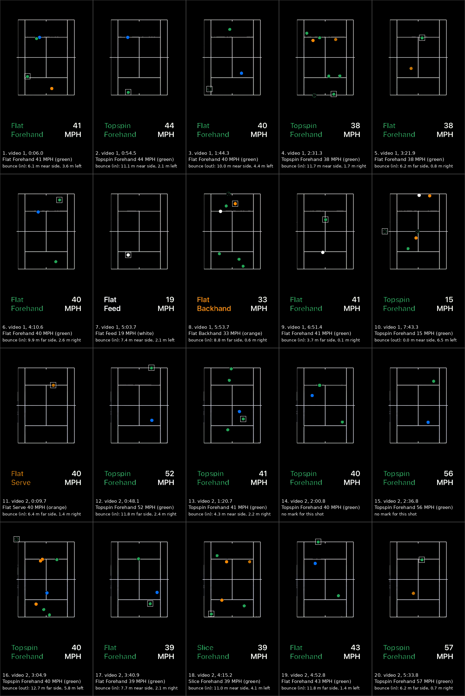

# Overlay reader 1: labels from SwingVision exports

19 Nov 2026. Chris's plan of 18 Nov: read the shot label and the mini court that SwingVision burns into its exports, as weak labels for the ball detector. Built on the two exports already in the session (25 Apr and 16 Apr 2025). Code: `vision/ml/overlay.py`.

**How it carries over to the GoPros:** it doesn't; it is only a source of labels. What it feeds (the detector and its training) is the same code in the two-camera system.

## What the overlay holds

- **The label's colour is the stroke, not the player.** Green is a forehand, orange a backhand or a second serve, blue a first serve, yellow a volley, white a feed.
- **A filled dot** on the mini court is a bounce SwingVision called in. It takes its shot's colour.
- **A ring** is its out call. A ring on the net line is a ball into the net, with no bounce.
- **Marks stay until the point ends.** The marks and the label clear 3 to 25 frames after each cut.
- **The mini court is not to scale:** its length is squashed, so across and along are converted separately. Its lines sit within 0.2% of a real court's proportions.

## What the reader does

1. Finds the mini court from its own lines, then lays out the mark area and the label relative to it.
2. Splits the export into points: a single-frame jump in the picture, or the overlay clearing.
3. Reads each label by matching its words and digits against the 10 words and 10 digits found in these exports (Flat, Topspin, Slice, Kick, Forehand, Backhand, Serve, Volley, Feed, MPH). An unknown word reads as "?" and is counted, never guessed.
4. Records each new mark with its first frame and its place in court metres.

## Results on the two exports

| | 25 Apr export | 16 Apr export |
| --- | --- | --- |
| Points | 49 | 38 |
| Shot labels read | 221 | 207 |
| Labels with unread ink | 0 | 0 |
| Bounces called in | 197 | 135 |
| Bounces called out | 13 | 14 |
| Net balls | 25 | 13 |
| Shots with no mark | 3 | 49 |

## How late is the dot, and is it in the right place?

Measured against the detector's own tracks, on the 49 bounce marks that fall inside stretches the detector had already been run on. The "real bounce" here is the frame where the tracked ball turns upward.

- **40 of 49** marks have a tracked turn within 1 m and 1 s.
- **Timing:** the dot appears on the frame of the bounce. Median 0 frames; 36 of 40 within 3 frames (0.05 s); the worst is 10 frames (0.17 s) late.
- **Place:** median 0.14 m from the tracked turn; 90% within 0.34 m.
- **The other 9:** 3 are out calls, two of them beyond the baseline where the detector doesn't track. For the other 6 the nearest tracked turn is 1.1 m or more away: either the tracker lost the ball or SwingVision's dot is off. Weak labelling is meant to sort out exactly these.
- **Not measured yet:** how the label's first frame relates to the hit. The mark follows its label by about 0.75 s (median 41 to 49 frames).

So for weak labels I'll search the detector's tracks within 0.2 s and 1 m of each dot.

## 20 shots to check by eye

Ten from each export, spread evenly, whatever they showed. Each panel is the overlay's own ink (nothing of the footage), with the mark the reader assigned to that shot boxed, and the reader's answer below it. Distances are from the net ("near side" is the camera's end) and from the centre line, as the mini court shows them.

To check one against the video: open the export at the time shown and compare.

| # | Export | Time | Label read | Colour | Mark read |
| --- | --- | --- | --- | --- | --- |
| 1 | 25 Apr | 0:06.0 | Flat Forehand 41 MPH | green | bounce (in): 6.1 m near side, 3.6 m left |
| 2 | 25 Apr | 0:54.5 | Topspin Forehand 44 MPH | green | bounce (in): 11.1 m near side, 2.1 m left |
| 3 | 25 Apr | 1:44.3 | Flat Forehand 40 MPH | green | bounce (out): 10.0 m near side, 4.4 m left |
| 4 | 25 Apr | 2:31.3 | Topspin Forehand 38 MPH | green | bounce (in): 11.7 m near side, 1.7 m right |
| 5 | 25 Apr | 3:21.9 | Flat Forehand 38 MPH | green | bounce (in): 6.2 m far side, 0.8 m right |
| 6 | 25 Apr | 4:10.6 | Flat Forehand 40 MPH | green | bounce (in): 9.9 m far side, 2.6 m right |
| 7 | 25 Apr | 5:03.7 | Flat Feed 19 MPH | white | bounce (in): 7.4 m near side, 2.1 m left |
| 8 | 25 Apr | 5:53.7 | Flat Backhand 33 MPH | orange | bounce (in): 8.8 m far side, 0.6 m right |
| 9 | 25 Apr | 6:51.4 | Flat Forehand 41 MPH | green | bounce (in): 3.7 m far side, 0.1 m right |
| 10 | 25 Apr | 7:43.3 | Topspin Forehand 15 MPH | green | bounce (out): 0.0 m near side, 6.5 m left |
| 11 | 16 Apr | 0:09.7 | Flat Serve 40 MPH | orange | bounce (in): 6.4 m far side, 1.4 m right |
| 12 | 16 Apr | 0:48.1 | Topspin Forehand 52 MPH | green | bounce (in): 11.8 m far side, 2.4 m right |
| 13 | 16 Apr | 1:20.7 | Topspin Forehand 41 MPH | green | bounce (in): 4.3 m near side, 2.2 m right |
| 14 | 16 Apr | 2:00.8 | Topspin Forehand 40 MPH | green | no mark for this shot |
| 15 | 16 Apr | 2:36.8 | Topspin Forehand 56 MPH | green | no mark for this shot |
| 16 | 16 Apr | 3:04.9 | Topspin Forehand 40 MPH | green | bounce (out): 12.7 m far side, 5.8 m left |
| 17 | 16 Apr | 3:40.9 | Flat Forehand 39 MPH | green | bounce (in): 7.7 m near side, 2.1 m right |
| 18 | 16 Apr | 4:15.2 | Slice Forehand 39 MPH | green | bounce (in): 11.0 m near side, 4.1 m left |
| 19 | 16 Apr | 4:52.8 | Flat Forehand 43 MPH | green | bounce (in): 11.8 m far side, 1.4 m left |
| 20 | 16 Apr | 5:33.8 | Topspin Forehand 57 MPH | green | bounce (in): 6.2 m far side, 0.7 m right |

My own check of the sheet: all 20 labels match the ink, and each boxed mark is where the reader says. Shots 14 and 15 have no mark of their own in the overlay.

## Limits

- **Layout:** written for 1920x1080 exports with the overlay in the top-right corner. Another size or layout needs its corner position and word shapes added.
- **New words:** a stroke or spin word not in these two exports (an overhead, a lob) reads as "?" until I name it once.
- **Marks on top of each other:** a new dot landing within about 0.7 m of an old one, in the same half second, is merged with it.
- **Cuts:** a few are placed up to 20 frames late, where the picture hardly changes at the cut.
- **Truth:** SwingVision's bounces are its own estimates. They are hints for training and never go in the fixed test set.

## A mistake found on the way

My first pass dropped 12 of the 16 Apr export's 20,462 frames when cutting out the overlay corner (that export is 60.04 frames a second, and the tool I used evens that out to 60 unless told not to). The dots then looked up to 11 frames early. Every frame is now kept, and the reader stops if the counts disagree.

## Next

1. Weak labels from the dots, with the guard that stops real balls being taught as "not a ball", when the new sessions arrive.
2. Per session: found hits and bounces against SwingVision's shots within each point (count and timing).

## The overlay is found in each video, not assumed (19 Nov)

Chris: app updates may move the overlay, so find its boxes per video. Until now the reader cut a fixed corner out of the picture and the calibration and detector masks used two hand-set boxes.

- `overlay.py prep` now starts with `find_layout`: it looks over the whole picture (a median of 24 frames spread through the export) for the mini court's line pattern at any place and size, and for the "Shots Tracked by SWINGVISION" watermark by its logo (a yellow disc in a green square that never changes, with white writing beside it). It writes `TAG_layout.json`: the panel cut, and the boxes to keep the ball detector and the court-line fit out of. The calibration and export scripts take their boxes from that file.
- On the three exports in hand it finds the panel at exactly the hand-set place (cut at 1620, 0, 300 x 480) and the watermark in the two exports that have one (1433, 928 to 1892, 1068; hand-set 1430, 925 to 1915, 1070), and none in the third, which has none.
- **Moved:** a 45-second copy with the whole picture shifted 300 px left and 180 px down: found at the shifted place; all 21 bounce marks read, on the same frames (within 3) and within 0.15 m; every shot label reads the same words and speed, no unread ink (one label's run is split in two by the re-encoding).
- **Moved and shrunk to 80%:** found at the right place and size. The marks still read (18 of 21 matched, within 0.11 m), but the words do not: 17 labels unread, because the word templates are for one size. The reader counts what it cannot read, so this shows up in its summary line rather than as wrong words. New templates would be needed if the app ever changes the overlay's size.
- The cut-finding between points now leaves out the overlay's own area wherever it is, instead of the picture's right-hand side.
