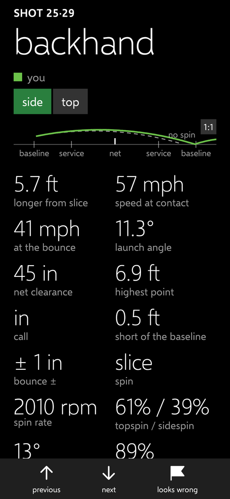
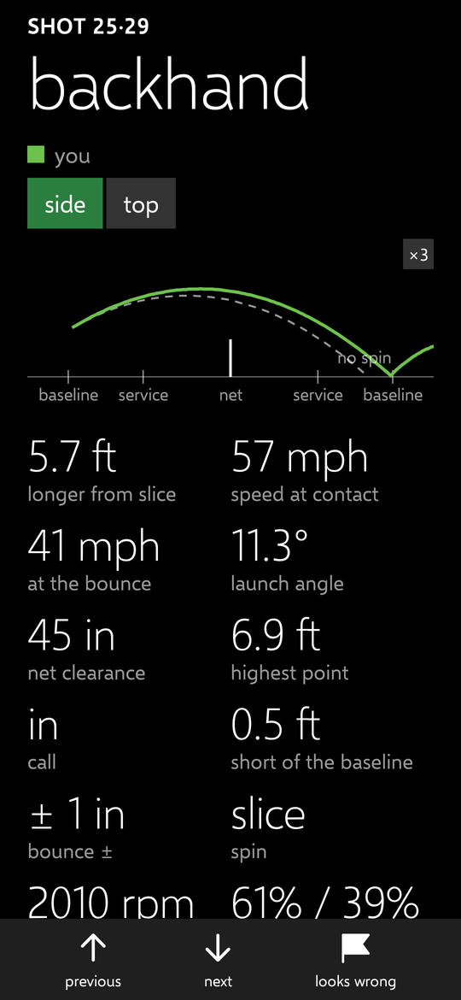
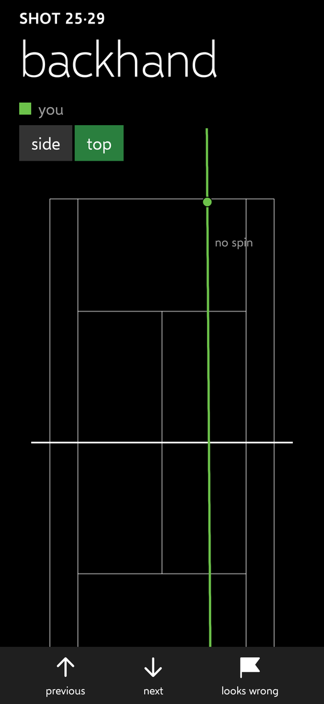
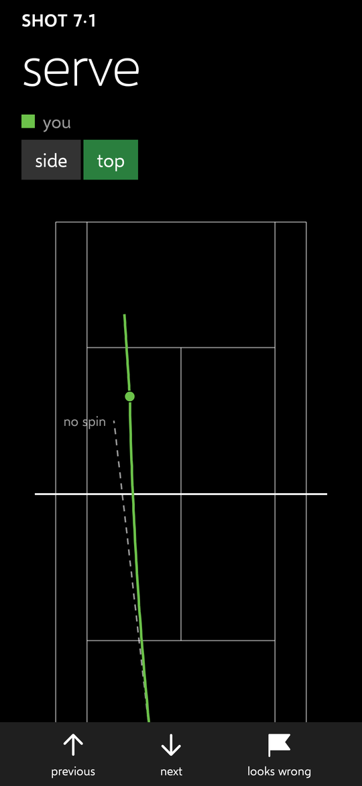
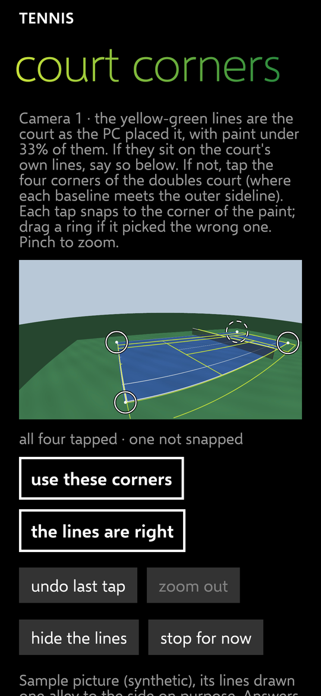
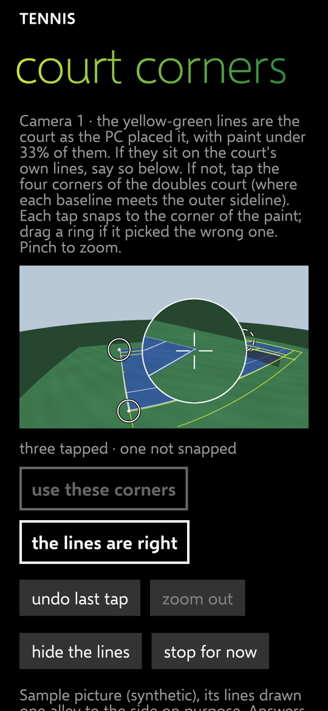

# Overnight, 20 Nov: answers, shot card, court corners, Tuesday

Chris's message of 19 Nov (late), Parts 1 to 4. Releases: v0.6.46 and later (see docs/STATUS.md for the last one). Every number here is from synthetic footage, the Python twin on Chris's own footage, or a measurement in this session, as each line says; nothing has run on the phone or the Legion.

## Part 1

### 1. A session waiting on Chris can't stall unnoticed
- When the court-line fit is doubtful the PC holds the session (Chris: A) and the phone gets the alert at once.
- **New:** while it waits, the phone is reminded every 12 hours (`heldReminderHours`), and the live tile shows "1 · session waiting: corners" ahead of the cues (it uses the tile face the launcher already draws for ball checks, so the launcher needs no change).
- Not live yet: the cloud service isn't deployed, so there is nothing real to count. The sample's check is never counted.

### 2. Every frame is processed
- `cfg.frames = 'all'` is the default: the learned detector runs over every frame of both recordings.
- Rallies are where the ball was in play (a quarter-second counts when a quarter of its frames hold a confident spot; joined under 4 s apart, 1.5 s before and 2 s after), joined with the sound's windows, so nothing either finds is left out.
- `session.json` keeps the sound's own windows and the share of the play they would have held (`rallyFinding`). That is the measurement for a cheaper first pass later: switch only when it misses under 1% on your sessions and you agree.

### 3. Why round 5 lost the neighbours test's second rally — found and fixed
| | |
|---|---|
| What CI showed (runs 52, 53) | Rally 2: flights from 20.6 to 22.3 s dropped at the flight fit with errors of 18 to 143 px; 4 to 5 of 9 shots found |
| 2D tracks | Clean. Your ball, the neighbour's and the stray each in their own track in both cameras (checked against the truth point by point) |
| The gate | Kept your ball **and the stray rolling across the court** |
| Why | The rolling test asked for *every* 3D point of the stray to be under 0.3 m. 90% were under 5 cm, but a few mis-paired points sat at 0.7 to 1.4 m |
| What followed | The flight fit takes one ball at a time; it mixed the stray with your ball, the fits failed, and two of your shots went |
| Fix | The test uses the 90th percentile of the heights (`rollShare` 0.9). Rally 2 then keeps only your ball (checked on the local run) |
| CI result | see docs/STATUS.md (run 55) |

It is not marked a known shortfall.

### 4. Processing time: 1.5 hours at 4K240, every frame
In docs/reports/PROCESSING-TIME-1.md. In short: 2,592,000 frames; with the code as it is today about 55 to 70 h; with spot-finding on the graphics card and frames passed through memory, **5 to 14 h, up to 18 h at worst** (no overlap, cautious spot-finding). NVDEC takes 3 to 4 h of decoding off the processor and runs beside the detector, but the spot-finding decides it. Fits 18 h only once those two are built. TV-OPS-04 and AC-12 now read 1.5 h in 18 h (item 26).

### 5. Detectors compared over hundreds of shots
Two steps (drawing whole 4K frames for hundreds of shots is out of reach here):
1. **By ball size**, on small rendered patches (`tools/detectorSizeStudy.m`, 150 balls per size, 240 fps, 1/1920 s shutter, the court coded once and the ball's blocks re-coded each frame):

| Ball (px) | Learned: spot on it / > 0.5 | Learned centre error, median | Before the new centre | Colour detector: found / centre error |
|---|---|---|---|---|
| 2 | 99% / 78% | 0.19 px | 0.30 px | 0% |
| 3 | 99% / 89% | 0.20 | 0.32 | 13% / 0.49 |
| 4 | 100% / 98% | 0.16 | 0.17 | 99% / 0.48 |
| 5 | 100% / 100% | 0.06 | 0.10 | 100% / 0.22 |
| 6 | 100% / 100% | 0.05 | 0.07 | 100% / 0.11 |
| 8 | 100% / 100% | 0.04 | 0.06 | 100% / 0.14 |

2. **Over a whole session** (`tools/shotStudy.m`, about 250 shots each, Tuesday's set-up): each detector's measured behaviour at the size the ball really is in each frame. Results: section "Tuesday's set-up" below, when CI finishes.

## Part 2: the shot card
| Side, 1:1 | Side, ×3 | Top | A slice serve from above |
|---|---|---|---|
|  |  |  |  |

- Title is the shot type; under it only who hit it. No caption, no legend, no "brought it down".
- "no spin" is written where the dashed line lands; the chip in the corner (×3 or 1:1) is the only sign of the stretch; the court labels are one row (baseline · service · net · service · baseline; the service labels drop to ticks when crowded).
- First tiles: the spin's effect ("5.7 ft · longer from slice"), then the sideways curve when it is 0.5 ft or more ("curved left from slice", left and right as the hitter saw it).
- "side · top" above the chart, remembered. The top view: the court lengthways in true proportion, singles and doubles lines, you at the bottom, the path solid, the same shot without spin dashed and straight, the bounce marked.
- Sample session: some shots now curve sideways. A slice's no-spin path used to land further on, like topspin's; it now lands shorter.
- **How well the two cameras measure sideways curve:** the shot study, below.

## Part 3: court corners
| Four corners, three snapped | The magnifier (finger on the fourth) |
|---|---|
|  |  |

- **Snap (15):** a tap looks for painted lines within 2% of the picture's width; the corner is where two of them cross at their outside edges (court sizes are to the outside edges), taken only where at least one of the lines ends there and no more than half that distance from the tap. Otherwise the tap stands and its ring is dashed: "not snapped". A ring can be dragged ("moved by hand").
- **Magnifier (16):** while a finger is down, a circle above it (beside it near the top) shows what is under it four times larger than the picture as shown, with a crosshair.
- **Zoom (17):** up to 16 times (was 9).
- **Do the taps matter? (18)** The taps only start the pose; it is then sharpened on all the court's lines (within 0.7 m and 2 degrees). `tools/cornerTapStudy.m`, synthetic pictures 1920 px wide:

| Taps off by (px) | Wide: camera from the truth | Linear: camera from the truth | Line support after |
|---|---|---|---|
| 0 to 12 | 0.7 cm | 0.4 cm | 94% / 99% (as the truth) |
| 25 | 8.5 cm median, 1.25 m worst | 0.4 cm | 94% / 99% |
| 50 | 67 cm median | 0.4 cm median, 1.05 m worst | 67% / 99% |

So tap accuracy hardly matters up to about 12 px at 1920 wide (25 px for Linear); beyond that the snap and the magnifier earn their keep.
- **Real pictures (19):** no Hero 7 side clip yet. On 13 far corners in the phone videos from behind a baseline the snap now declines 11 and snaps 2 (5 and 15 px from the corner the earlier fit puts there). The first version jumped 30 to 50 px to wrong crossings on these, so it now only snaps when sure. On the synthetic sample: 2.5 to 3.6 px from the true corner from taps 11 to 16 px off; the corner under the net post declines. The real test is a GoPro picture from beside the court.
- Also from this: the court model put every line's centre on the court's nominal size; sizes are to the outside edges, so each centre was 2.5 to 4 cm too far out. Fixed (`tv.court.lines`).

## Part 4: Tuesday
- **20. Field checklist:** the user manual, section 16 (about 90 minutes; what each test proves).
- **21. Ground truth:** `tools/groundTruthReport.m` with `vision/groundtruth/template.json`: gravity and release height from each 2-metre drop (a free parabola through the 3D points, nothing assumed), still balls placed by the two sight lines against where they were put, bounces against the taped crosses, the machine's spread per setting, and the camera positions against the tape. Tested on made-up inputs with known answers.
- **22. Synthetic test matching Tuesday:** the shot study (below).
- **23. Quick look:** `tools/quickLook.m`. Upload whole files to Drive (manual 16.5); I cut 10-second stretches with FFmpeg reading over the link, so only the needed parts download. One calibration serves all clips (`cfg.calibFrom`); timing is solved per clip from the ball.
- **24. Mission 1 Pro files:** `tools/checkCameraFile.m` runs on the first file: name and chapters, the LRV beside it, codec and bit depth, picture size, frame rate and every frame's own time (dropped or doubled frames), start time (timecode or creation time), telemetry (serial, model, GPS, gyro), the real shutter, ISO and white balance, the sound. Tested on GoPro's HERO8 sample. Only a real file can show: the Mission 1 Pro's naming and chaptering at 4K240, whether it writes a timecode track and an LRV, its GPMF tags, its codec at 4K240 (HEVC 10-bit or 8-bit, 4:2:0 or 4:2:2), and how long a chapter is.
- **25. Far-end misses:** next section.
- **26.** Done (Part 1 item 4).
- **27. PC readiness:** the manual's section 2.1 opens with a short checklist, a new step checks FFmpeg sees the graphics card's decoder (`ffmpeg -hwaccels` must list cuda), and the benchmark judges a 1.5-hour 4K240 session against 18 hours.

## 25. The 19 far-end misses (video 8, round 5, Python twin)
Video 8's SwingVision marks: 59 bounces, 28 missed by the one-camera bounce scoring, 19 of them at the far end. For each one (`far_miss.py`, `far_miss2.py`; numbers only, no frames):

| Question | Answer, 19 far misses |
|---|---|
| Ball size | 3.3 to 5.1 px across |
| Motion spots on it in the frames round the bounce | Yes in all 19 (7 to 303 spots near the mark's path) |
| Classifier | Best spot on the ball scored about 1.0 in 17; under 0.05 in 2 (frames 0 and 4136) |
| Tracker | In the same 17 a tracked path runs into and out of the bounce (6 to 18 frames before, 3 to 18 after); in the 2 there is no path through it |
| Where the tracked bounce is | 7 to 45 px from SwingVision's mark in the picture (median 17 px). At the far end one pixel is 0.08 to 0.27 m of court depth (median 0.13 m), so 17 px is about 2 m on the ground |
| Ground error of the tracked bounce | 1.1 to 11 m, median 1.7 m. The scoring counts a bounce found only within 1 m |

**What this says.** The ball was found and followed; the "miss" is in where one camera puts the bounce on the ground, not in finding the ball. With one camera the bounce's depth comes from a single image point at a very shallow angle, so a few pixels (the ball's lowest point taken a frame early or late, the ball's own size, or SwingVision's mark itself) become metres. A ball-size threshold or a different detector would not change this:
- test-set recall does not drop with size (round 5, over 0.5: 3 px 15 of 15, 4 px 8 of 8, 5 px 3 of 5, 6 px and over 5 of 7);
- the size study finds 98 to 100% at 4 px and over.

**Fix it points to:** score bounces where the flight fit puts them (the two halves of the path meeting at the ground), not at the lowest image point. In the one-camera twin this needs the fitted flight in 3D, which one camera can't give well at the far end.
**Does it carry over to two cameras?** No. With two cameras the bounce is where the two sight lines cross: the side camera sees the far bounce's depth across its picture, not along it. The synthetic Tuesday study measures that error directly (next section). The 2 classifier misses are the only detector work: frame 0 is the very first frame of the video (no frames before it to compare), and frame 4136 scored 0.01 on all 45 spots near it; I'll look at it with the next training round's hard examples (weak labels stay out of the test set).

The 9 near-end misses are different: the tracked ball is 110 to 320 px from the mark, so the tracker followed something else or the mark is on another bounce. Not chased tonight: the near end is the side the two-camera set-up sees best.
