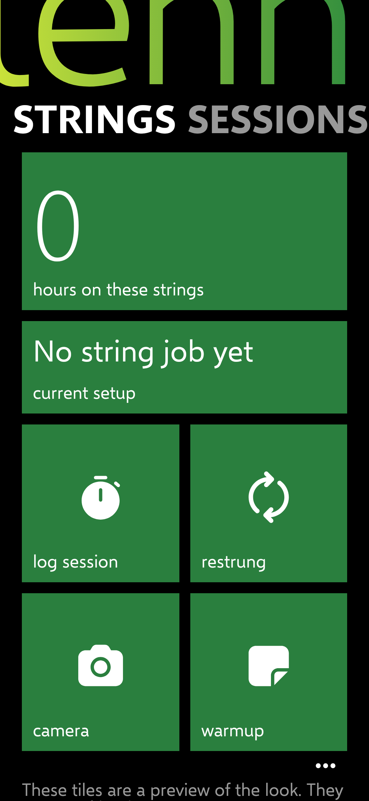
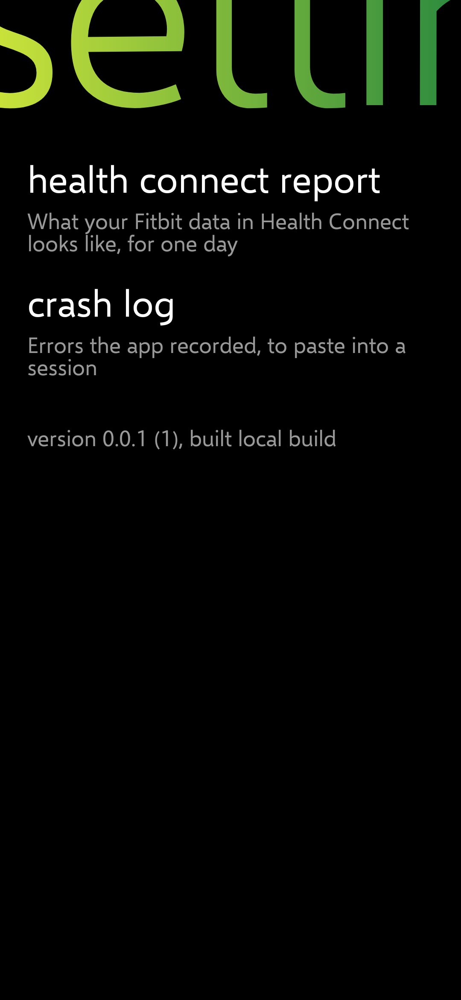
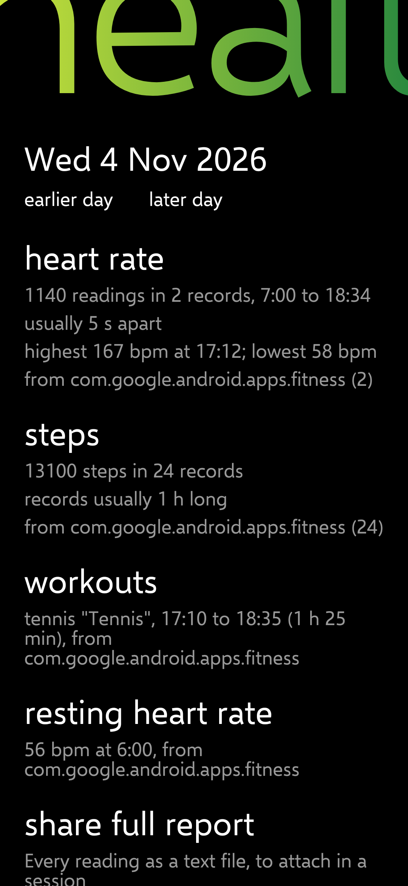
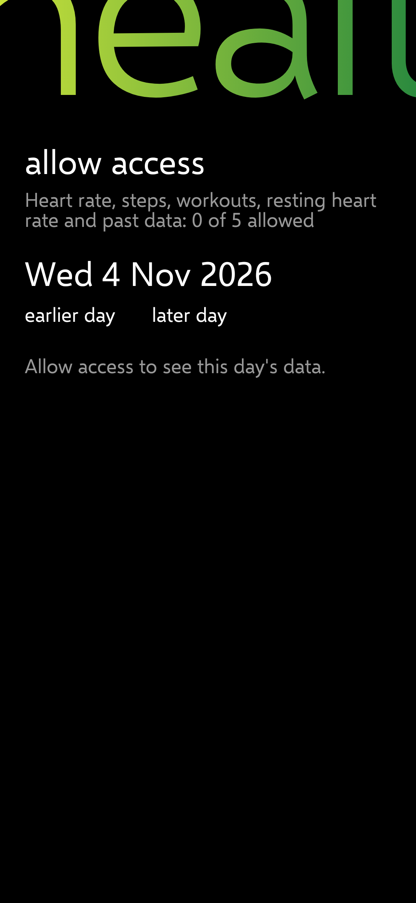
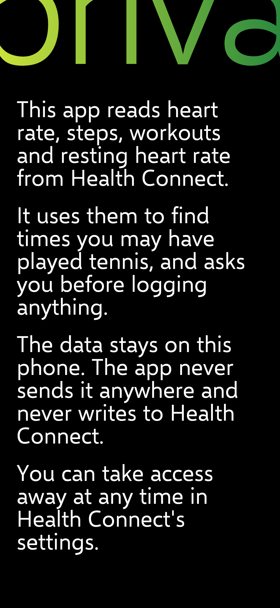

# PH-0 report: foundation and Health Connect report

Release: [v0.0.2](https://github.com/Wotworth/tennis/releases/tag/v0.0.2) (CI run 2 passed: build, 24 unit and screenshot tests, permission check, APK signed with the release key) · Key SHA-256 `C9:8E:F4:98:A8:39:C9:7F:94:5A:E3:84:6F:A4:A2:9B:29:F0:8A:D8:52:0C:DD:7F:7C:2C:5F:8B:29:D6:4B:4C`

## Done

| IDs | What |
| --- | --- |
| PLT-01 to PLT-05 | Package `io.github.wotworth.tennis`, min SDK 34, target 37. CI on main builds a signed release APK, runs the tests and publishes a prerelease; versionCode is the run number, versionName 0.0.run. No debug-key fallback. |
| NFR-02 | Crash log (last 20 entries) in settings, with share. |
| NFR-05 | CI fails if the release manifest declares a permission not in `ci/allowed-permissions.txt`, and proves the check rejects a manifest with INTERNET. |
| VIS-01 to VIS-04, VIS-06 to VIS-08 | Selawik and the Zune type roles; the giant title in the yellow-green to deep-green gradient; flat green tiles with the tilt; Fluent glyphs; black, edge to edge, status bar visible. Contrast unit tests pass (both gradient stops and white on the tile green ≥ 4.5:1). |
| NAV-01, NAV-02 (preview), NAV-08 | The hub `tennis` with five swipe pivots (strings, sessions, stats, library, cues), the Zune pivot motion, the strings tiles as a static preview, and settings from the "…" at the bottom right. |
| DET-01, DET-02 | Settings → health connect report: asks for access, reads one day (earlier/later, up to 30 days back), shows a summary per data type with the writing app, and shares every reading as a text file. Privacy page for Health Connect's permission screen. |

Not in PH-0 (later phases): everything that stores data; the tiles don't work yet.

## Decisions

See DECISIONS.md (2026-11-05): Chris's answers; what was copied from the Zune player; EC signing key; gradient end `#2B8A3E`; the wordmark icon; tiles two per row; the "…" app bar; the report's day range; the permission allowlist.

## Screenshots (JVM renders, 360 dp)

| Strings pivot | Cues pivot | Settings |
| --- | --- | --- |
|  |  |  |

| Report (made-up tennis day) | Report before access | Privacy page |
| --- | --- | --- |
|  |  |  |

## Test steps for Chris

1. Install the APK from the release page. The app is called **tennis**, with a green icon.
2. Swipe left and right through the five pivots. Check the green and the gradient title; tap a tile and check it tilts (it does nothing else yet).
3. Tap **…** (bottom right) → **health connect report** → **allow access**. Turn on everything Health Connect lists, including past data.
4. Tap **earlier day** until you reach a day you played tennis. Check that heart rate, steps and workouts show something.
5. Tap **share full report** and send the file to yourself (Drive or Gmail), then attach it in the next session.
6. Install the next build over this one when it comes, to check updates install without uninstalling.

## Known issues

- Nothing has run on the phone yet.
- Wrapped grey lines sit close together; to revisit in PH-1 if they read badly.
