# PH-1 report: logging, racquets, the pivot title

Release: [v0.1.3](https://github.com/Wotworth/tennis/releases/tag/v0.1.3) (tag `ph-1`; CI passed: build, 46 tests, permission check, signed). Built overnight on 5–6 Nov without Chris's input; every choice is in DECISIONS.md.

## Done

| IDs | What |
| --- | --- |
| NAV-01 (v0.3) | Windows Phone pivot: small "TENNIS" title, large lowercase headers, the current one in the green gradient, the next peeking in. Opens on **cues**; strings, sessions, stats and library to its right. |
| RAC-01 to RAC-05 | Several racquets (name, model, colour), each with its own restrings and hours. One-tap switcher on the strings page; long-press a name to edit or delete; `+` to add. Sessions ask which racquets (several allowed, last used preselected); a shared session splits its time. |
| NAV-02 (v0.3) | Strings page tiles with real numbers in mixed sizes: hours, tension, days strung, feel with its trend line, the wide setup tile, small log and restrung tiles; this racquet's restrings below. **Three layouts** to choose from in settings → strings page: grid, hero, mixed. |
| STR-01 to STR-05, STR-20, STR-30 | Restring form pre-filled from the racquet's last job ("· changed" marks edits), hybrids, tensions, shop, price, notes; shop order card (screen stays on); string library filled automatically. |
| SES-01 to SES-05 | Session form: date, length presets and ±15 min, racquets, feel 1–5, notes. Sessions list. |
| CUE-01, CUE-02, CUE-10 | Cues page = warmup view: pinned cues large, others below; add with +, long-press to pin, move, edit or delete; screen stays on. |
| DAT-01, DAT-02 | Local database; export and import a zip (data and photos) in settings → backup. |
| NFR-05 | Permission check now also covers WorkManager's permissions (allowed with reasons; still no INTERNET). |

Not yet: detection (PH-2), launcher tile (PH-3), photos (PH-4), stats (PH-5).

## Screenshots (JVM renders, 360 dp, made-up data)

| Cues (opens here) | Cues with a detected session | Strings: grid | Strings: hero | Strings: mixed |
| --- | --- | --- | --- | --- |
| 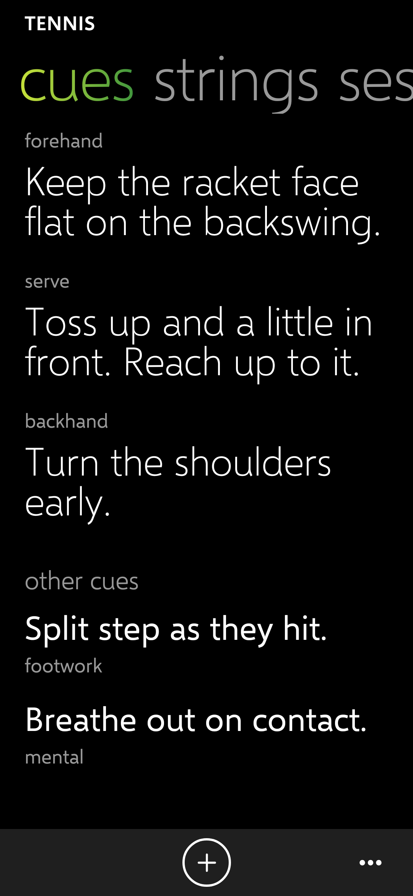 | 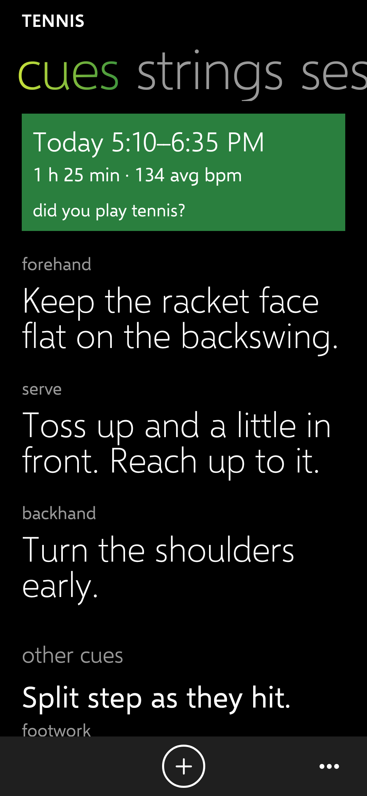 | 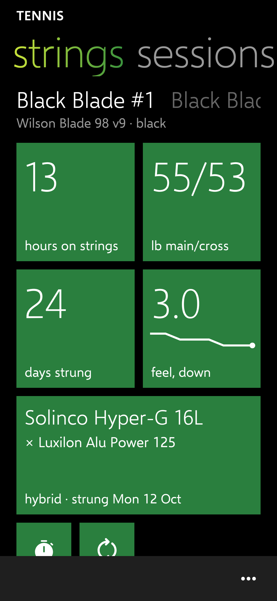 | 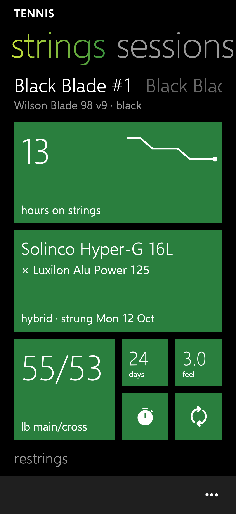 | 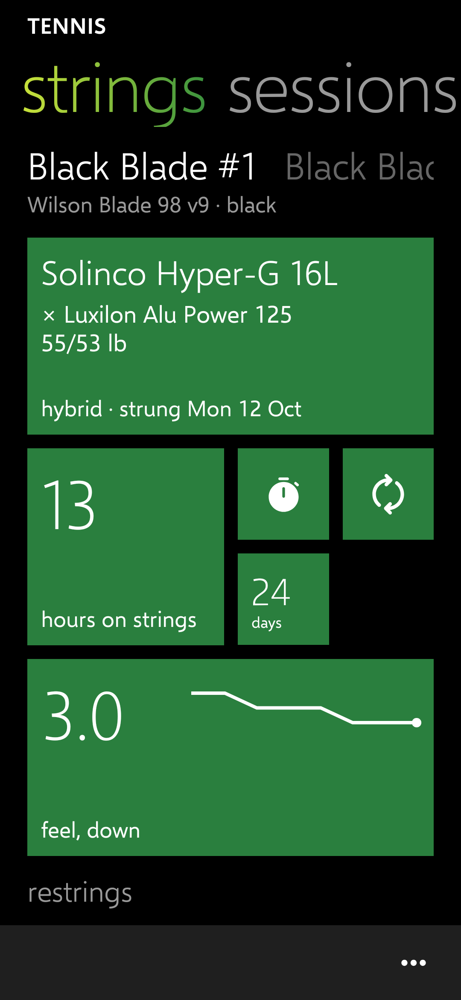 |

| Sessions | Library | Restrung form | New session | Shop order |
| --- | --- | --- | --- | --- |
| 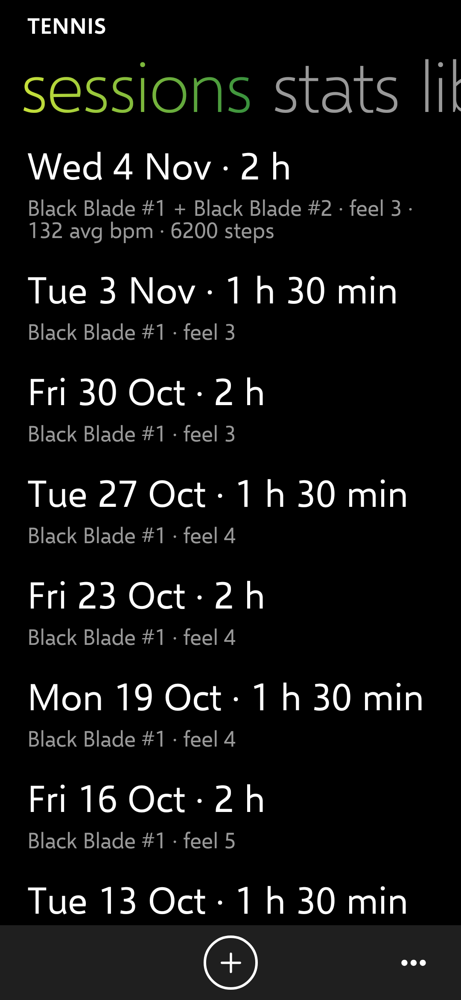 | 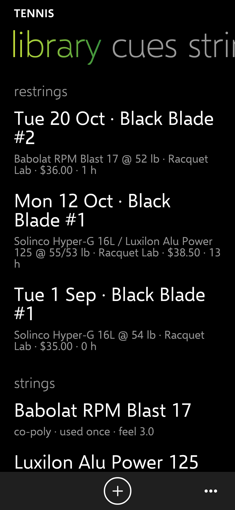 | 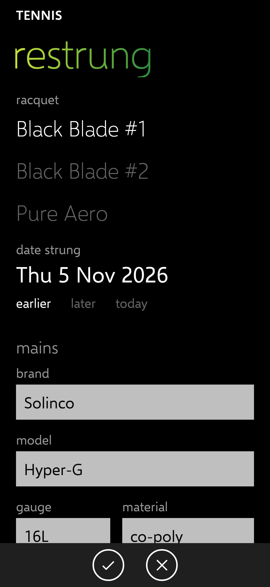 | 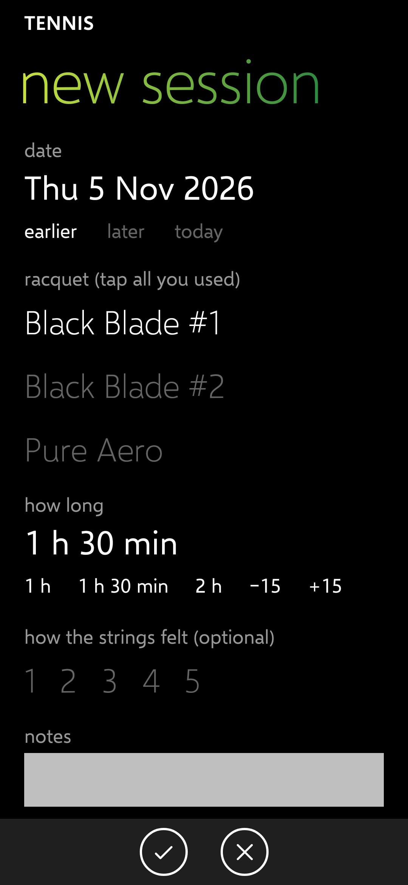 | 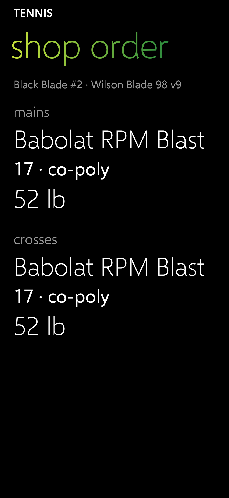 |

| Yes/No prompt | Settings | First launch (strings) |
| --- | --- | --- |
| 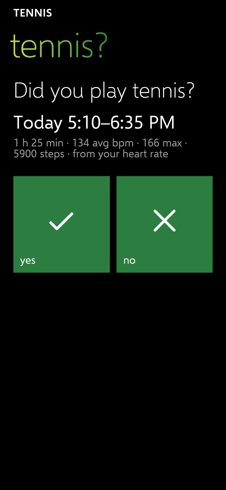 | 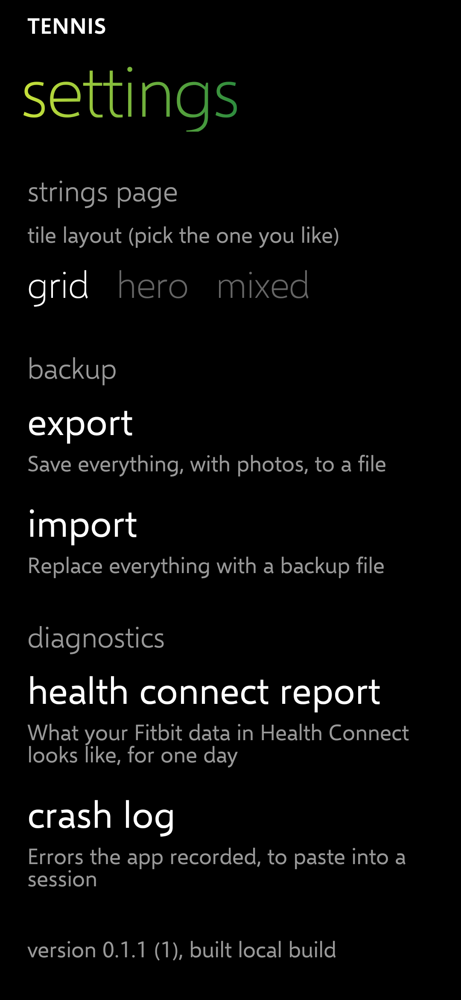 |  |

## Test steps for Chris

1. Install the PH-1 release over PH-0. It opens on **cues**.
2. Swipe left to **strings** and tap **+ add racquet**; add two or three racquets. Tap a name to switch.
3. Tap the **restrung** tile (circular arrows) and log each racquet's current strings. Try **hybrid**.
4. Tap the **log session** tile (stopwatch), pick two racquets, a length and a feel, then save. Check each racquet's hours.
5. Settings (**…**) → **strings page**: try **grid**, **hero** and **mixed**, and tell me which you want.
6. Add a few cues with **+** on cues; long-press one to pin or move it.
7. Settings → **export**, save the file to Drive.

## Known issues

- Nothing has run on the phone yet.
- The racquet choice in forms lists names one per line when they are long; fine for 3–4 racquets.
