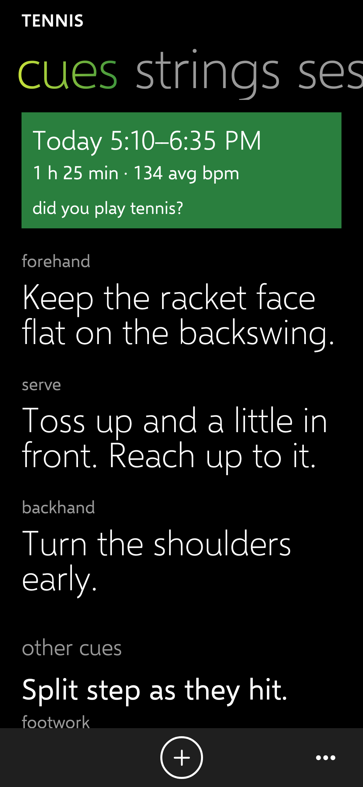
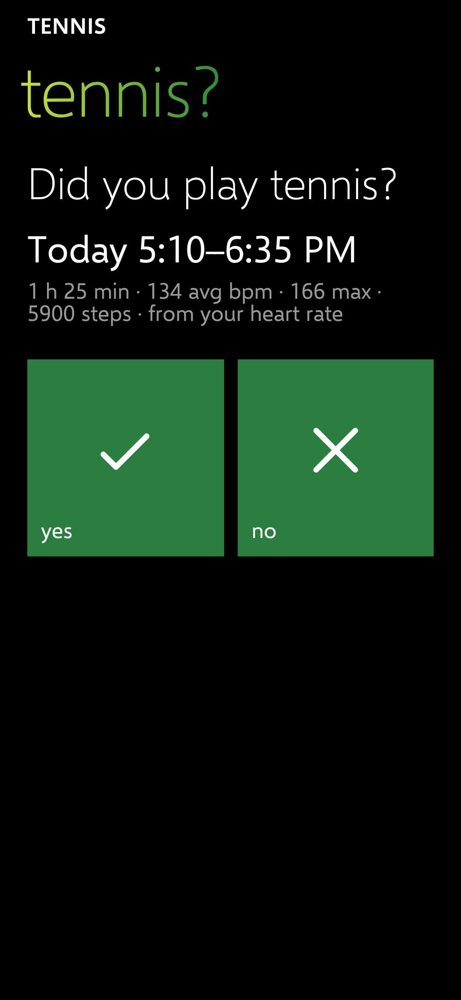
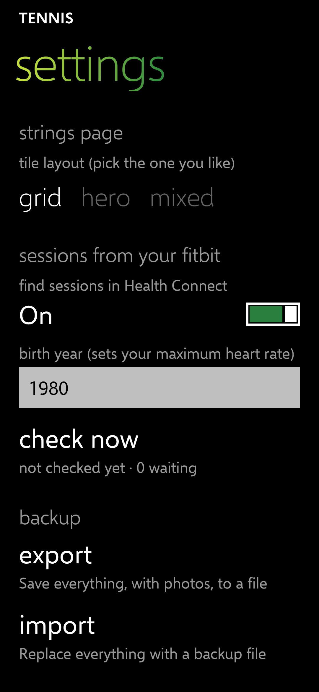
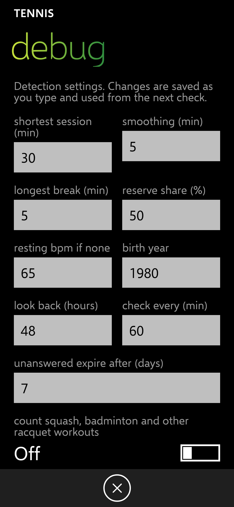

# PH-2 report: sessions found from your Fitbit

Release: [v0.2.4](https://github.com/Wotworth/tennis/releases/tag/v0.2.4) (tag `ph-2`; CI passed). Built overnight; choices in DECISIONS.md (DET rows, 5 Nov).

## How it works

Designed from your 4 Nov Health Connect report (docs/health-connect-findings.md).

1. **Workouts first.** If Fitbit logged a tennis workout in Health Connect, its start and end are used. (Your report had none, so this is untested on real data.)
2. **Otherwise heart rate.** Each minute's average heart rate, smoothed over 5 minutes. A session is at least **30 minutes** at or above your threshold, allowing breaks of up to **5 minutes** (water, changing ends). Minutes when the watch has no readings are never counted as low.
3. **Threshold:** resting heart rate (from Fitbit; 68 on 4 Nov) plus **half** your heart-rate reserve. Your maximum is 220 − age, so **set your birth year** (settings → detected sessions); it defaults to 1980. With resting 68 and that default, the threshold is 121 bpm. On 4 Nov your highest minute average was under 120.
4. **Numbers attached:** length, average and maximum heart rate, and steps (Fitbit's, not also the phone's).
5. **Never silent:** a "did you play tennis?" tile appears on cues, strings and sessions. Yes opens the session page filled in, asking which racquets and how the strings felt; No drops it for good. Unanswered ones disappear after 7 days.
6. **When:** checked every hour in the background and whenever you open the app, looking back 48 hours, since Fitbit syncs late.

**Tuning without a new build:** settings → long-press the version line → **debug**. Every number above can be changed there, and **try a day** runs detection on any past day (back a year) and shows what it would find, with the threshold and the longest stretch above it, without saving anything.

## Done

| IDs | What |
| --- | --- |
| DET-02 | Background-read permission added (asked with the others). |
| DET-10 to DET-13 | Detection as above; 12 unit tests built on the shape of your 4 Nov data (an ordinary day finds nothing; tennis with a water break is found and clipped; watch-off gaps split a window; steps prefer the watch; workouts win; logged sessions block; a growing sync updates the waiting proposal). |
| DET-20, DET-30, DET-31 | Hourly background check, check on open, Yes/No prompt, expiry. |
| DET-01 | The report reaches back a year (week and month steps). |

## Screenshots (360 dp, made-up data)

| Proposal on cues | Yes/No | Settings | Debug |
| --- | --- | --- | --- |
|  |  |  |  |

## Test steps for Chris

1. Install the PH-2 release over PH-1.
2. Settings (**…**) → **detected sessions**: type your birth year, then tap **check now** and allow everything Health Connect asks, including **access in the background**.
3. Long-press the version line at the bottom of settings → **debug** → **try a day**. Step back (month/week earlier) to a day you played before the injury, tap **run on this day**, and send me a screenshot of what it says. If it misses the session or finds yard work, I'll tune from that (or you can change the numbers there yourself).
4. Optional: start a **Walk** workout on the Charge 6 for 10 minutes; next day, run **try a day** on it to see whether the workout appears ("workout in Health Connect: …").

## Known issues

- Nothing has run on the phone. Whether Fitbit workouts reach Health Connect is still unknown.
- Android decides exactly when the hourly check runs (it may be later on battery saver).
