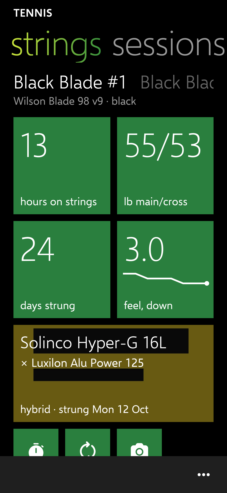
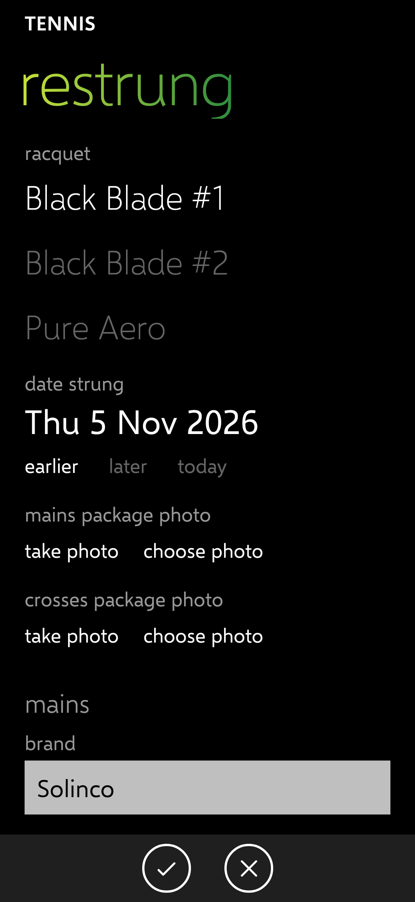
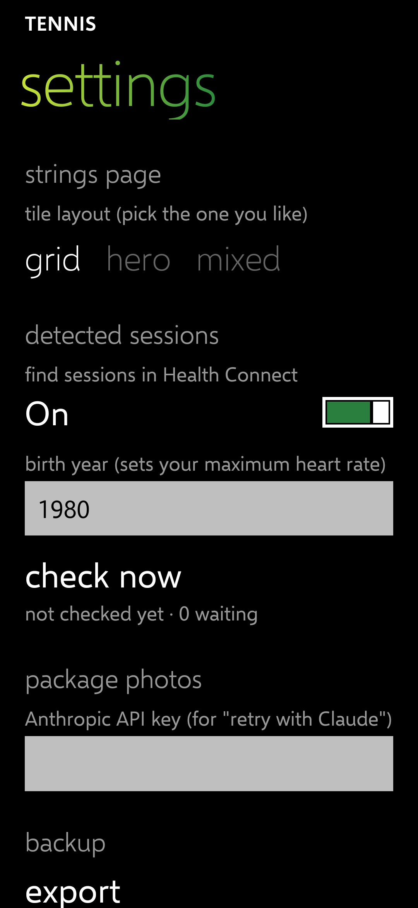

# PH-4 report: string package photos

Release: [v0.4.7](https://github.com/Wotworth/tennis/releases/tag/v0.4.7) (tag `ph-4`; CI passed on the second build, after the permission check fix in DECISIONS.md). Choices in DECISIONS.md (PHO rows, 5 Nov).

## Done

| IDs | What |
| --- | --- |
| PHO-01, PHO-02 | Camera tile on the strings page (a new restring for that racquet, camera first); "take photo" and "choose photo" on the restring form (mains, and crosses for a hybrid) and on a string in the library. Photos stay with the job as the record and go into the export. |
| PHO-10 | Each new photo is read on the phone (ML Kit, offline) and fills brand, model, gauge and material; "read again" repeats it. |
| PHO-20, PHO-21 | "retry with Claude" sends the photo to Claude Sonnet 5.5 with your API key; offline it says "Needs an internet connection" and sends nothing; a bad key, rate limit or server error each get a plain message. |
| PHO-22 | Settings → package photos: paste your API key once; it is encrypted on the phone and only its last four characters are shown. |
| PHO-23 | INTERNET is used only for this (HTTPS to api.anthropic.com). |
| NAV-02 | The mains package photo shows behind the setup tile, darkened for the white text. |

Tests: 73 pass (8 new: package text from Luxilon, Solinco, Babolat and Wilson-style packages, the gauge table, Claude's answer, the encrypted key).

## Screenshots (360 dp, made-up data and photo)

| Photo behind the setup tile | Restring form with photo slots | Settings with the API key |
| --- | --- | --- |
|  |  |  |

## Test steps for Chris

1. Install the PH-4 release.
2. Strings page → the **camera** tile. Photograph a string package; the form fills in. Check and correct, then save.
3. If something is wrong, tap **retry with Claude**. The first time it asks for your API key: settings → package photos → paste it → **save key** (create one at console.anthropic.com if needed).
4. Turn on airplane mode and tap **retry with Claude**: it should say it needs an internet connection.
5. For a hybrid, switch **hybrid** on and photograph the crosses package too.

## Known issues

- Nothing has run on the phone. The Claude request is untested against the live service (no key in the session); the on-phone reading is tested only on typed package text, not real photos.
