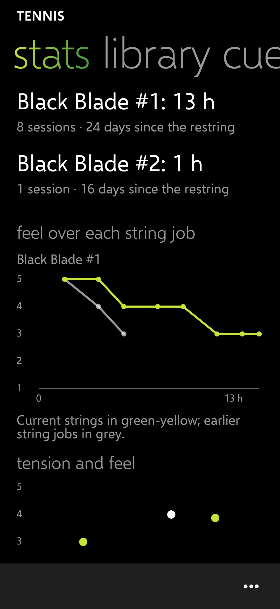
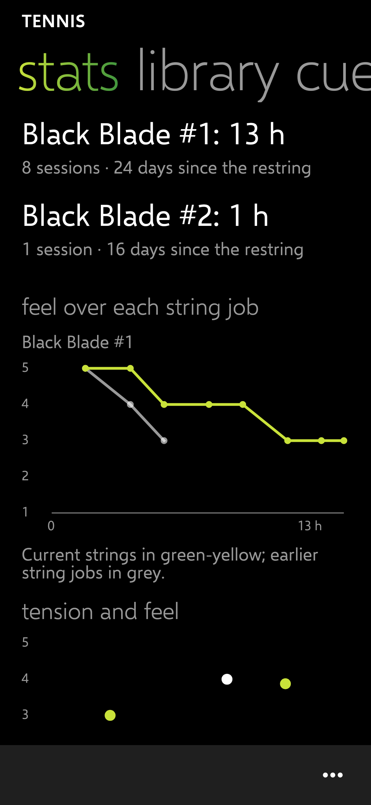

# PH-5 report: stats (and cues)

Release: [v0.5.8](https://github.com/Wotworth/tennis/releases/tag/v0.5.8) (tag `ph-5`; CI passed).

## Done

| IDs | What |
| --- | --- |
| STA-01 | Each racquet: hours, sessions and days on its current strings. |
| STA-02 | Feel against hours played, one line per string job of the racquet shown on the strings page; current strings in yellow-green, earlier ones grey. |
| STA-03 | Mains tension against average feel for every string job with ratings, as dots and as a list (with hours each job lasted). |
| STA-04 | Each year: restrings, money spent, average hours per string job. |
| STA-05 | Drawn in the app's own style, no chart library. |
| CUE-01, CUE-02, CUE-10 | Built in PH-1 (cues is the first page): warmup view, add, edit, pin, move, delete. |

Tests: 78 pass (4 new on the stats numbers).

## Screenshots (made-up data)

| 360 dp | 411 dp |
| --- | --- |
|  |  |

## Test steps for Chris

1. Install the PH-5 release.
2. Swipe to **stats**. With a few sessions rated, check the feel line and the tension list make sense.
3. On **strings**, switch racquet, then go back to **stats**: the feel chart follows the racquet.

## Known issues

- Nothing has run on the phone. Charts get busy past about 4 string jobs per racquet (only the last 4 are drawn; tunable).
