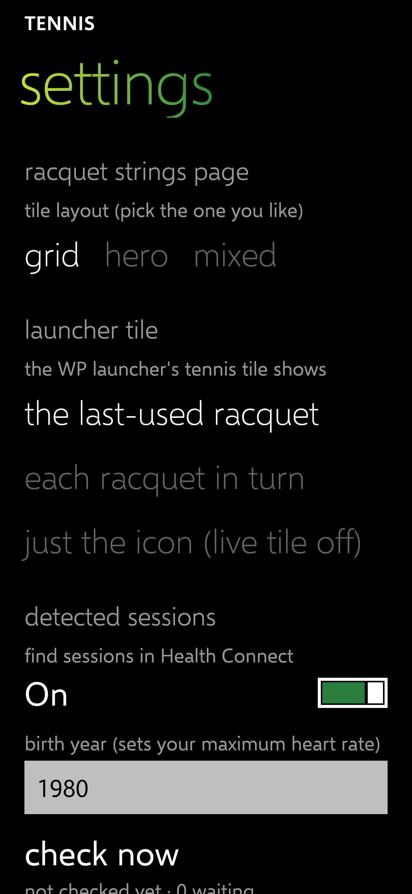

# Launcher tile: text that fits, an off switch, a racket icon

Releases: tennis _added once CI publishes it_ (tag `tile-1`); launcher _added once CI publishes it_ (checkpoint `tennis-tile-fit`, from launcher main).

## What changed

| Where | What |
| --- | --- |
| Tennis | Settings → **launcher tile** has a third choice, **just the icon (live tile off)**: the tile shows no hours and no found sessions, just the racket icon. |
| Tennis | New app icon: a plain white tennis racket on the tile green (it also shows in the app list). It replaces the "tennis" wordmark. |
| Tennis | Shorter tile text: one racquet: **14.5** over "hours on strings"; several racquets: **14.5 h** over the racquet's name. |
| Launcher | The tennis tile's line under the number is cut with "…" to the tile's width, with the same margin as the number. Only the tennis tile; no other tile changes. |

Tests: tennis 96 pass (3 new); launcher 211 pass, unchanged.

| Racket icon (medium tile, and the app icon) | Settings |
| --- | --- |
|  |  |

## Test steps for Chris

1. Install both releases (tennis and launcher).
2. On Start, the tennis tile shows **0 h** over **RF01 Pro Hall of Fame**, inside the tile.
3. Tennis settings → launcher tile → **just the icon (live tile off)**; press Home: the tile shows only the racket icon.
4. If you don't like the racket drawing, tell me and I'll change it or go back to the wordmark.
