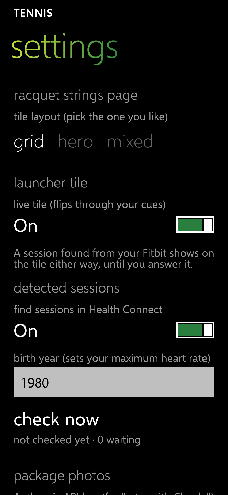

# Live tile: your cues, sized to fit

Releases: tennis [v0.6.13](https://github.com/Wotworth/tennis/releases/tag/v0.6.13) (tag `tile-2`); launcher [v0.9.173](https://github.com/Wotworth/wp-launcher/releases/tag/v0.9.173) (from launcher main, includes fix-8 from v0.9.167). Spec v0.7 (TIL-05).

## How it works

- **Front:** one of your cues; it flips to the next one each time round. Only cues that fit **in full** at the tile's size are used: whole words, no "…", text at Windows 10 Mobile's body size or, at the smallest, the normal tile-label size, inside the same 8-point margins as the tile's label, and above the label. A cue that doesn't fit is skipped. Resizing the tile or editing a cue re-checks which fit.
- **Back:** your last session's day and length ("Wed 4 Nov" over "2 h"); with none logged, "0 sessions this month".
- **No cue fits** (almost always the small tile): the white racket icon; a small tile doesn't flip.
- **Found session:** "Tennis?" over "Today 5:10–6:35 PM" takes over the tile, even with the live tile off, until you answer Yes or No.
- **Tap:** the Yes/No prompt when a session is waiting; otherwise the app opens on **cues**.
- **Settings → launcher tile → live tile:** off shows only the racket icon, no flipping, no text.
- Still no notifications.

Tests: tennis 95 pass; launcher 217 pass (211 before, unchanged; 6 new on fitting and face order).

| Racket icon (medium tile, and the app icon) | Settings |
| --- | --- |
|  |  |

## Test steps for Chris

1. Install both releases (tennis and launcher).
2. On Start, the tennis tile (medium) should show a short cue at the top-left, then flip to your last session, then to the next cue. Long cues are skipped.
3. Make the tile wide: more cues should appear in the rotation. Make it small: just the racket.
4. Edit a cue to be much shorter; press Home: it joins the rotation.
5. Tennis settings → launcher tile → turn **live tile** off: the tile shows only the racket.
6. When a found session is waiting, the tile shows "Tennis?" and the time; tap it: the Yes/No prompt.
7. Tell me if you want the racket icon changed.
