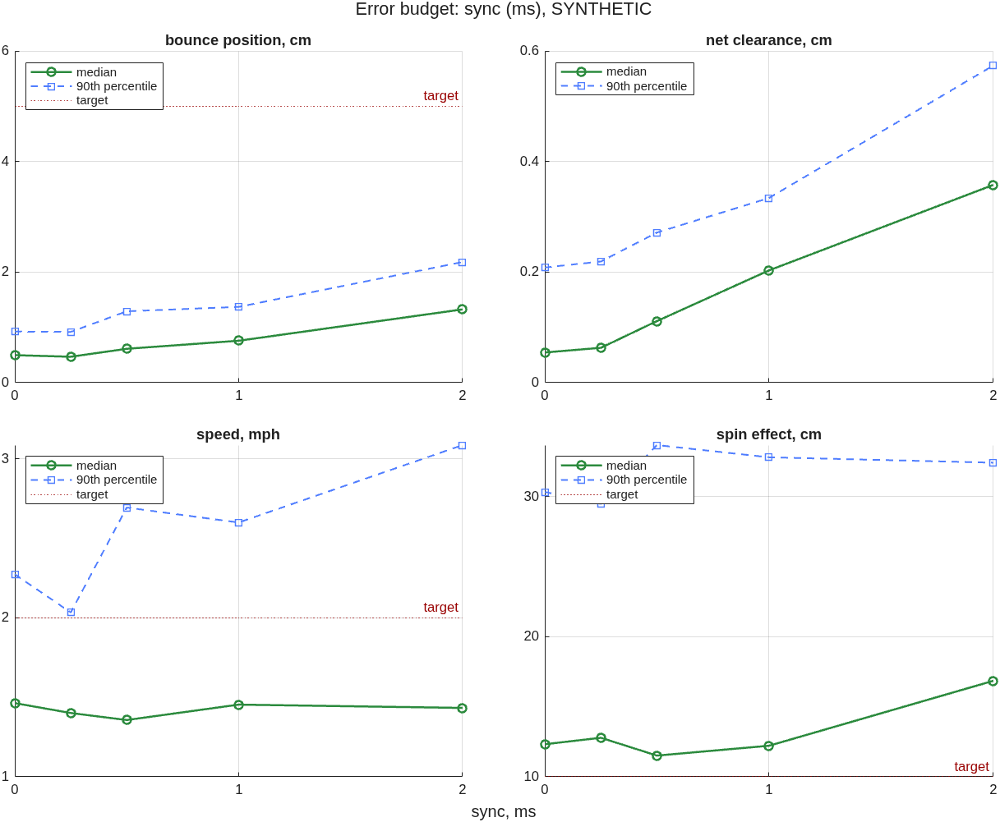
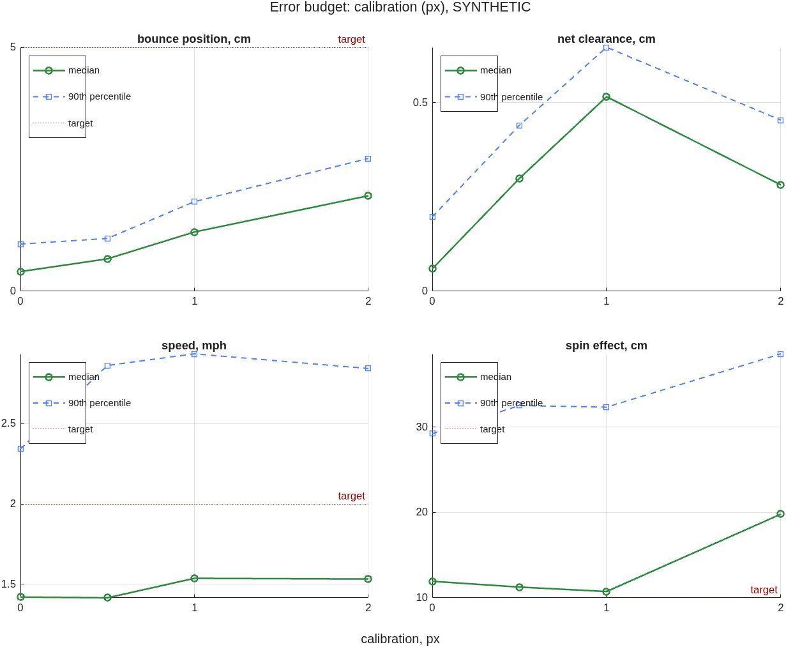
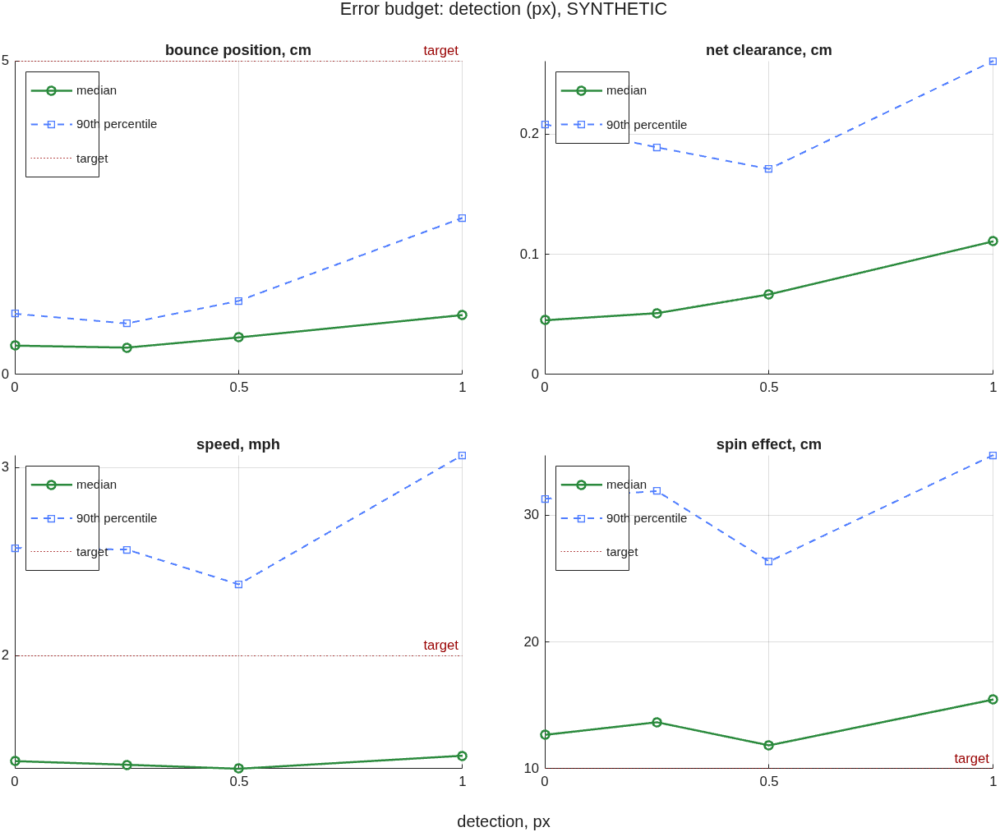
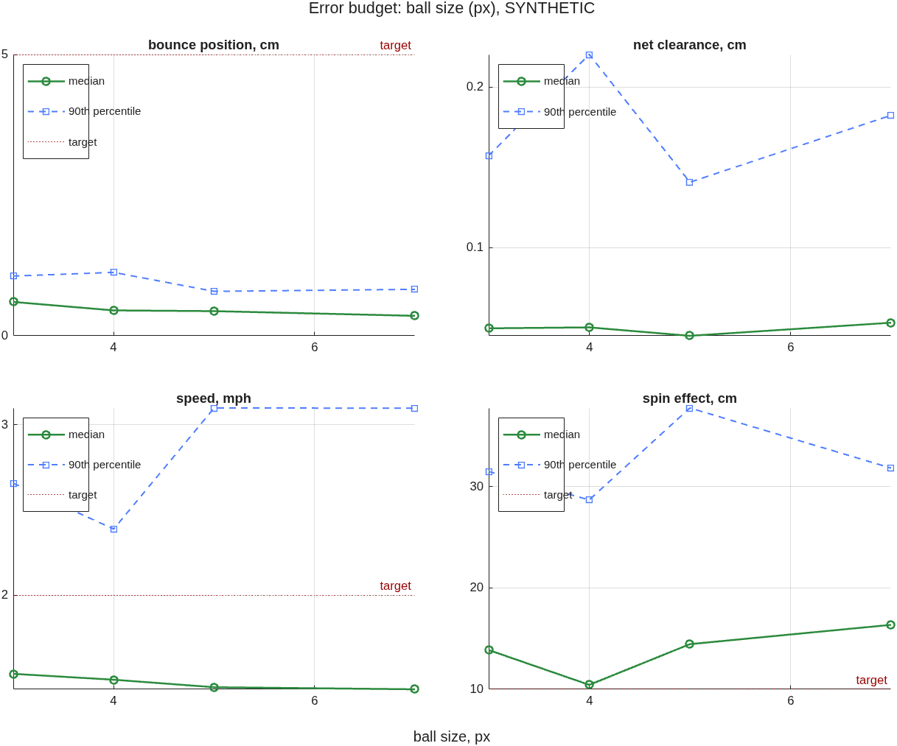
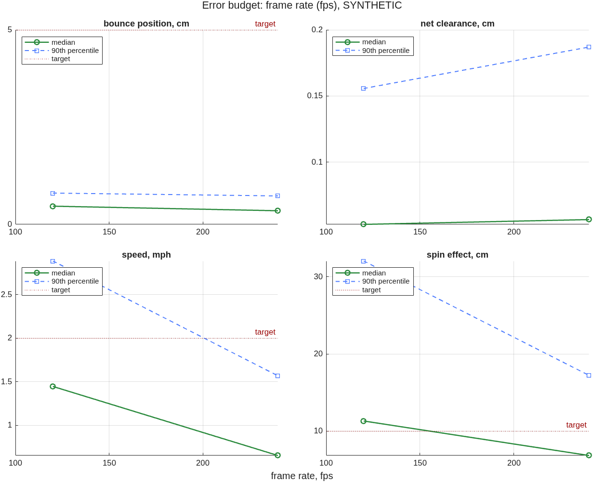

# Error budget (overnight item 5, 16 Nov) — SYNTHETIC

What each error source costs each measurement, and which source to fix first. Made by `vision/tools/errorBudget.m` in the CI job `error-budget` (run 43802368750, 3 h 15 min). Full table: [TV-ERROR-BUDGET/errorbudget.md](TV-ERROR-BUDGET/errorbudget.md); numbers: [errorbudget.csv](TV-ERROR-BUDGET/errorbudget.csv).

## How it was run

- One synthetic singles session, 49 shots. Truth flown with the truth model (spin decay, lift that follows the spin with 15% scatter, per-shot drag, gusts), which the fitter does not assume.
- Reconstructed once per setting, with ONE error source changed and the others at zero (detector noise 0.3 px except in its own sweep).
- Timing and air are held at the truth plus the error. The session refinement, which would absorb part of a sync error, is off, so the sync results are the worst case.
- Sweeps: sync 0 / 0.25 / 0.5 / 1 / 2 ms; calibration 0 / 0.5 / 1 / 2 px; detection noise 0 / 0.25 / 0.5 / 1 px; ball size 3 / 4 / 5 / 7 px; frame rate 120 / 240 fps.

## The main finding

**At the realistic error levels, the measurement errors are small next to the floor.** The floor is the error with every source at zero. It comes from the fitter's simplified flight (constant spin, constant lift) against the truth model, and from 120 fps sampling. It already breaks AC-07, AC-10 and AC-11.

| Measurement | Floor (all zero, 120 fps) | Target | Realistic sources together add |
|---|---|---|---|
| Bounce position, median | 0.5 cm | 5 cm (AC-08) | about 1 cm (calibration most) |
| Net clearance, median | 0.1 cm | 3–5 cm (estimate) | about 0.5 cm (calibration) |
| Speed within 2 mph | 85% | 90% (AC-07) | a few points |
| Spin effect, median | 12 cm | 10 cm (AC-10) | about 2 cm (ball size) |
| rpm, median | 16% | 10% (AC-11) | nothing measurable |
| Shots found | 94–98% | 95% (AC-06) | nothing measurable (run-to-run ±2%) |

**240 fps is the one change that moves the failing three:**

| | 120 fps | 240 fps |
|---|---|---|
| Speed, median / 90% | 1.45 / 2.88 mph | 0.66 / 1.57 mph |
| Speed within 2 mph | 74% | **98%** (meets AC-07) |
| Spin effect, median / 90% | 11.3 / 32.0 cm | **6.8** / 17.2 cm (meets AC-10 median) |
| rpm, median | 19% | 22% (no better) |

This goes into the TV-PH-2 capture-mode decision, with the processing time per mode from the benchmark (TV-OPS-04).

## Which source dominates

At realistic levels (sync 0.5 ms, calibration 1 px, detection 0.5 px, ball 3 px, 120 fps), as the rise over the floor:

| Measurement | First | Second | Third |
|---|---|---|---|
| Bounce position | calibration +0.72 cm | sync +0.11 | ball size +0.10 |
| Net clearance | calibration +0.46 cm | sync +0.06 | detection +0.01 |
| Speed | ball size +0.07 mph | calibration +0.07 | (frame rate is the floor itself) |
| Spin effect | ball size +1.6 cm | (others within run-to-run noise) | |

So **calibration** is the one to get right for positions (lines, bounces, net), and **frame rate** for speed and spin. Sync at the spec's 0.5 ms costs almost nothing. Even at 2 ms it adds only 0.8 cm to bounces.

## Flags against the acceptance targets

- **AC-04, AC-05:** the 2 px calibration and the 1–2 ms sync settings are outside their own targets. The other measurements stay within AC-08 even there (bounce 2.0 cm at 2 px).
- **AC-06 (95% found):** 94% in a few runs, 96–100% in the rest. With 49 shots one shot is 2%, so this is noise, not a source. The 400-shot fit study gives the real figure.
- **AC-07 (speed):** fails at 120 fps in every setting (71–88%), passes at 240 fps (98%).
- **AC-08 (bounce):** passes everywhere, 0.4–2.0 cm median.
- **AC-10 (spin effect):** median 10.4–19.8 cm at 120 fps, fails in all but none; 6.8 cm at 240 fps.
- **AC-11 (rpm):** fails everywhere, 15–22%. This is mostly the test design, not the cameras: the truth gives each shot's lift 15% random scatter about the spin curve, so even a perfect lift measurement is about 10% off in rpm on the median shot. AC-11 says "true C_L(S) known", which the scatter breaks. The spec gives rpm ±25% anyway (TV-SPN-03).

## Plots

One per source, each with bounce, net clearance, speed and spin effect (median and 90th percentile, with the target).

## What I'd do with this

- Nothing yet: it is synthetic, and the floor depends on how real balls differ from the truth model.
- At TV-PH-2, weigh 240 fps (speed and spin pass) against its processing time from the benchmark.
- Keep AC-11 as is for real footage (radar or a spin-measuring rig). For the synthetic check, either drop the 15% scatter (truth C_L known, as AC-11 says) or accept ~15% there. Logged in DECISIONS.md: synthetic AC-11 is scored without the scatter from the next build.
