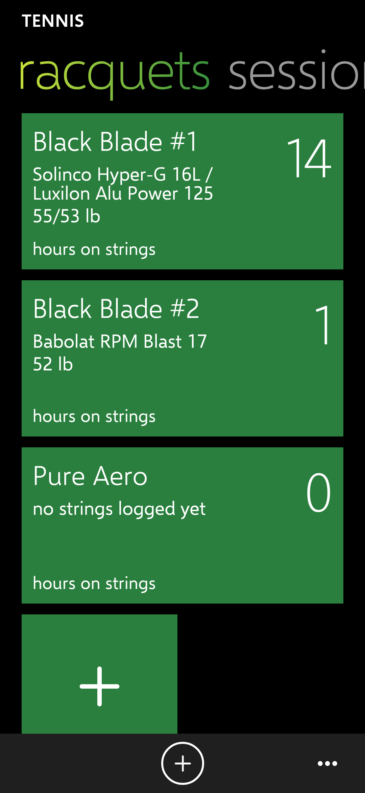
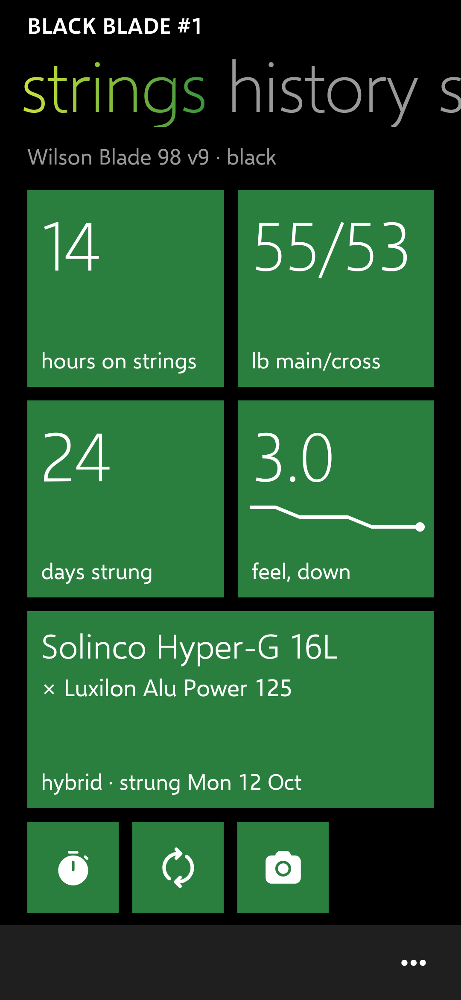
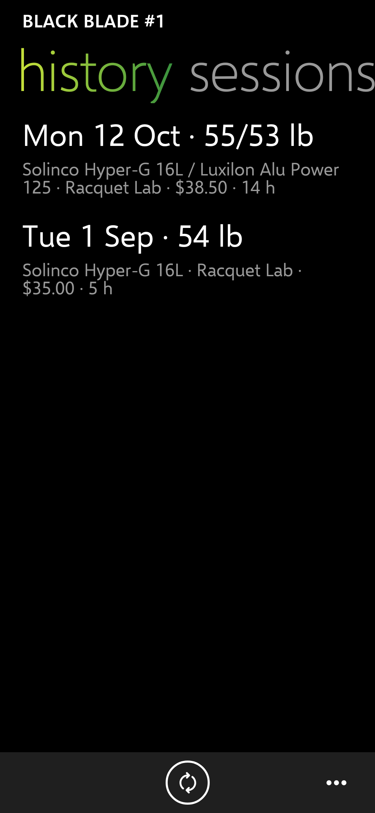
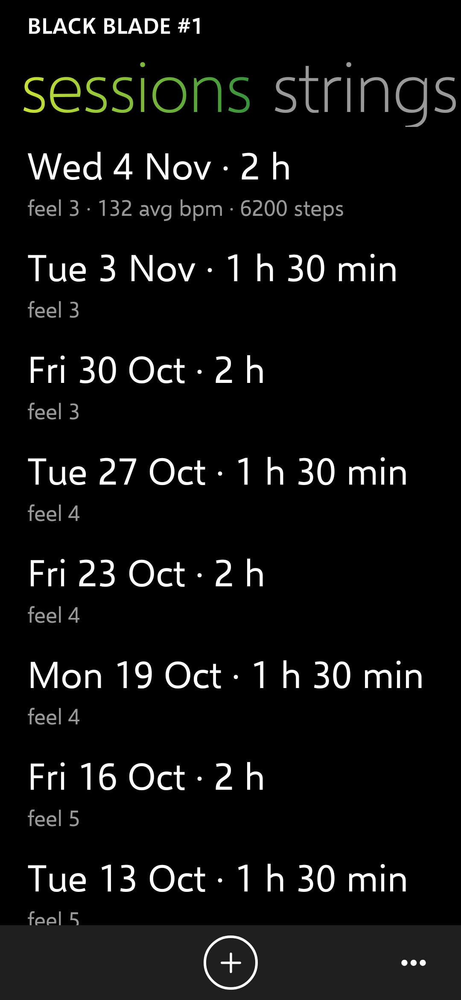
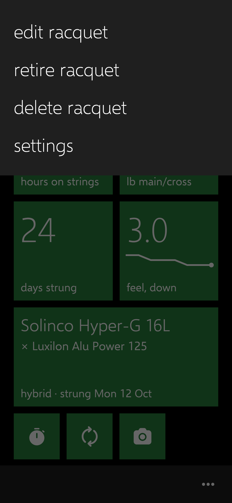
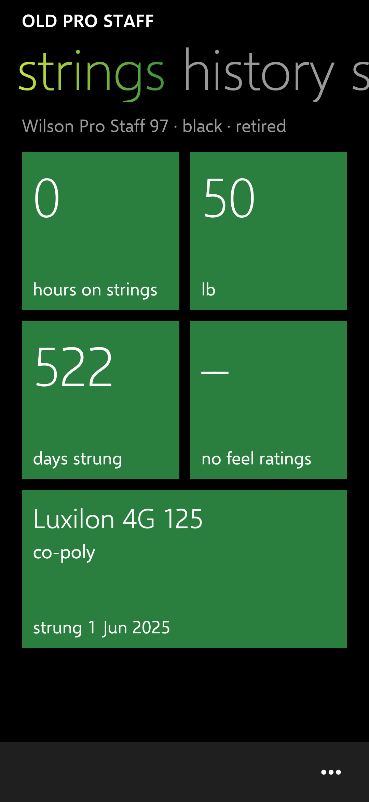
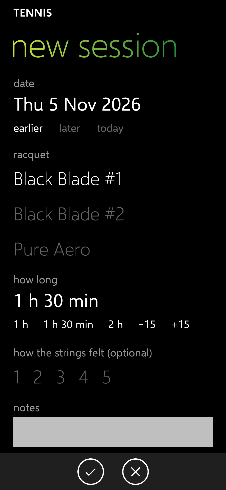
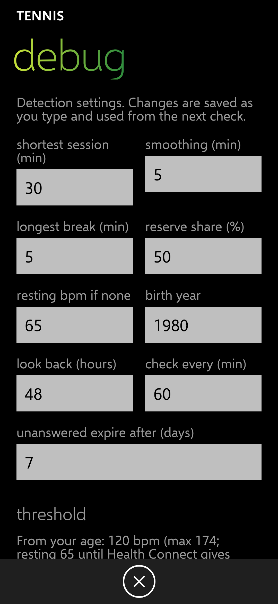

# Update 1 (v0.6): racquets pivot, one racquet per session, learned threshold, network limited to Anthropic

Release: [v0.6.9](https://github.com/Wotworth/tennis/releases/tag/v0.6.9) (tag `update-1`; CI passed: build, 91 tests, permission and network checks, signed). Launcher: [v0.9.163](https://github.com/Wotworth/wp-launcher/releases/tag/v0.9.163), from launcher main (211 unit tests, emulator smoke and end-to-end tests passed). Spec v0.4. Choices in DECISIONS.md (rows dated 2026-11-06).

## What changed

| IDs | What |
| --- | --- |
| NAV-01, RAC-04 | "strings" is now **racquets**: one wide tile per racquet (name, strings, tension, hours big at the right; the package photo behind it), then **+ add racquet**. Any number of racquets; the page scrolls. |
| RAC-04 | Tapping a racquet opens its own pivot, titled with its name: **strings** (your chosen tile layout), **history** (its restrings, with a restrung button) and **sessions** (only its sessions, with a log button). |
| RAC-06 | "…" in a racquet's pivot: edit, **retire** (or bring back), delete, settings. Retired racquets are listed under **retired** at the bottom of the racquets page, with their history. |
| RAC-05, RAC-03 | A session has **one racquet**, preselected (the racquet you came from, else the last used); tap another name to switch. Hours count the whole session for that racquet. |
| RAC-07 | Your data carries over: a database upgrade adds "retired" and keeps the first-chosen racquet of any two-racquet session. Tested from the old database. |
| DET-14 | The detection threshold is learned from your sessions once 3 have heart-rate data (88% of their middle average); 220 − age is only the start. Hand-logged sessions get their heart rate from that day's hardest stretch of the logged length. Debug shows both thresholds and which is used. |
| DET-15 | Past-data access is requested with the rest (report, check now, and **allow access** in debug → try a day, which warns when a day over 30 days back can't be read). |
| PHO-23 | The app can reach **only api.anthropic.com** (see below). |
| TIL-03 | Settings → **launcher tile**: the last-used racquet, or **each racquet in turn** (the launcher flips through them). |

Tests: 91 pass (13 new: migration, one racquet per session, retired racquets, tile faces, learned threshold, best window).

## The network (PHO-23), exactly

- **PH-4's first build failed** because CI's permission check proves itself by checking a sample manifest that asks for INTERNET and expecting a rejection. Once INTERNET was allowed for the Claude retry, that sample stopped failing. The fix changed only the sample: it now asks for precise location, which is never allowed. The real allowlist was not loosened beyond adding INTERNET.
- **What INTERNET allowed until now:** Android's INTERNET permission is all-or-nothing, so the app could have connected to any HTTPS host; only the code kept it to Anthropic (one class, a fixed address).
- **Now:** the network security config trusts no certificates for any host except exactly api.anthropic.com, and allows no plain HTTP. An HTTPS connection to any other host fails its certificate check inside Android, whatever code tries it. One side effect: ML Kit's anonymous usage logging (Q10) can no longer reach Google.
- **CI:** a new network check fails the build if the config trusts any other host, allows plain HTTP, includes subdomains or has debug overrides, and proves itself on a config that trusts every host.
- Not tested on the phone: CI checks the config file; Android applies it.

## Screenshots (360 dp, made-up data)

| Racquets | A racquet: strings | History | Sessions |
| --- | --- | --- | --- |
|  |  |  |  |

| Its "…" menu | A retired racquet | New session (one racquet) | Debug: thresholds |
| --- | --- | --- | --- |
|  |  |  |  |

## Test steps for Chris

1. Install this release over v0.5.8. Your racquets, restrings and sessions should all still be there.
2. Swipe to **racquets**: one tile per racquet. Tap **+** (tile or app bar) to add a third or fourth.
3. Tap a racquet: its name is at the top; swipe **strings**, **history**, **sessions**.
4. Tap **…** → **retire racquet** on one: it moves under **retired** at the bottom of the racquets page, history intact. Open it → **…** → **bring back racquet**.
5. Log a session from a racquet's **sessions** page: that racquet is preselected; tap another to switch.
6. Settings → **launcher tile** → **each racquet in turn**; on Start the tennis tile should flip between racquets (needs the new launcher release).
7. Debug (long-press the version in settings) → **threshold** shows the age estimate now; after 3 sessions with heart rate it switches to yours.
8. Optional network check: settings → package photos → **retry with Claude** still works with your key.
